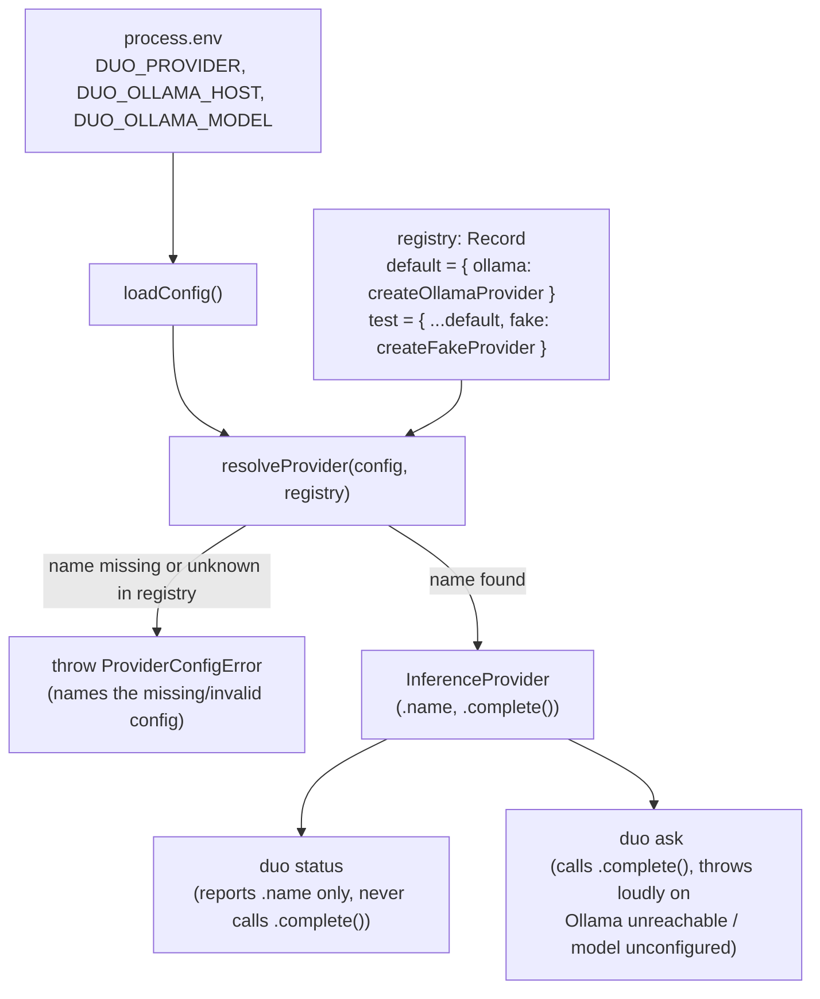

# CLI and Provider Interface Foundations - Plan

## Goal Capsule

- **Objective:** A developer on a clean checkout can install dependencies, run the `duo` CLI, and immediately see which inference provider and local store are configured — and the moment any command needs inference without valid provider configuration, the process fails loudly and specifically instead of guessing or silently substituting a different provider.
- **Means:** A TypeScript CLI (`commander`) backed by a single `InferenceProvider` interface with exactly one production implementation — a local Ollama HTTP client — selected through an injectable provider registry so swapping providers later is a configuration change (KTD1-KTD3).
- **Authority hierarchy:** GitHub issue #16's acceptance criteria and out-of-scope list are authoritative over this plan; the two settled decisions below (Ollama-only, scope discipline) are authoritative over any implementation convenience.
- **Stop conditions:** any of R1-R6 below unmet; any call site outside the provider module imports a provider SDK, issues an inference HTTP request directly, or hardcodes a hosted provider.
- **Execution profile:** `code`, Standard depth, no test-first mandate beyond the per-unit scenarios below.
- **Tail ownership:** the implementer (`ce-work` or equivalent) runs `npm run typecheck`, `npm test`, and `npm run build` before considering a unit done.

---

## Product Contract

### Summary

Scaffold the TypeScript project and `duo` CLI entrypoint that every later backlog issue builds on, and stand up an inference provider interface with exactly one working implementation — a local Ollama client. `duo status` reports configuration; any command that needs inference fails loudly, by name, when that configuration is missing; and the provider is swappable by configuration alone.

### Problem Frame

Issue #16 is the first of 72 backlog issues. Nothing exists yet — no `package.json`, no source tree. It establishes the skeleton that `docs/v1-tech-design.md` Part 4's numbered build order builds on, starting with step 1 (`Record` schema, SQLite store, Claude-export adapter) — work this plan explicitly defers (Scope Boundaries). Every later issue (store schema, adapters, derivation, drafting) assumes this skeleton is already in place and that inference is never called through anything but the interface, so re-pointing at a different provider later is a config change, not a rewrite.

### Requirements

**CLI and configuration reporting**
- R1. Given a clean checkout with dependencies installed, running `duo status` prints the configured provider name (or an explicit "not configured" state), the configured store location, and whether a file exists at that location, then exits 0.
- R2. `duo --help` lists every implemented command (`status`, `ask`).

**Provider interface and failure behavior**
- R3. Every inference call in the codebase goes through one `InferenceProvider` interface; no call site outside the provider module imports a provider SDK or issues an inference HTTP request directly.
- R4. When a command that performs inference runs with no provider configured, or a configured provider missing required settings, the process exits non-zero with a message naming the specific missing configuration, and never falls back to a different provider.
- R5. The only production implementation behind the interface is a local Ollama client — no hosted API calls, model and host both configurable, no blocking TODO in place of real behavior.

**Swappability**
- R6. Pointing configuration at a different registered provider (proven with a test-only fake, since production intentionally ships only one) changes no call site, and `duo status` reflects the newly selected provider's name.

### Key Decisions

- **Ollama is the only inference provider implementation built now.** (session-settled: user-directed — chosen over defaulting to or stubbing a hosted provider: deliberate placeholder that keeps corpus data local; `docs/v1-tech-design.md:80-86` already names Ollama as the local-inference fallback.) Governs R3, R5.
- **This issue builds strictly to #16's acceptance criteria; store schema, adapters, derivation, and drafting logic are deferred to later backlog issues.** (session-settled: user-directed — chosen over folding in forward-looking functionality now: issue 1 of 72 needs a small, clean surface for the rest of the backlog to build on.) Governs R1, R6, and Scope Boundaries below.

### Scope Boundaries

**Out of scope (per issue #16):**
- Any ingest, derivation, or drafting logic.
- Multi-user configuration or hosted deployment.

**Deferred to Follow-Up Work:**
- SQLite store schema and implementation (`docs/v1-tech-design.md` build order step 1 covers the `Record` schema itself; this issue only reports a path and existence flag).
- A second real (hosted or local) provider implementation.
- An on-disk config file format — this issue uses environment variables only.
- `duo purge` and any other future command.

---

## Planning Contract

### Key Technical Decisions

- KTD1. **Ollama client is a raw `fetch` call against `/api/generate`, no SDK dependency.** (session-settled: user-directed — chosen over installing a hosted-provider SDK as a stand-in: Governs R3, R5 above; keeps the only HTTP/inference code inside the provider module.)
- KTD2. **Provider selection and Ollama connection settings come from environment variables (`DUO_PROVIDER`, `DUO_OLLAMA_HOST`, `DUO_OLLAMA_MODEL`), not a config file.** Rationale: zero new dependencies, standard for a CLI skeleton, and avoids inventing an on-disk config schema before a later issue needs one (Scope Boundaries).
- KTD3. **Provider construction goes through an injectable registry, `resolveProvider(config, registry?)`.** (session-settled: user-directed — chosen over shipping a second real provider to prove R6: the settled Ollama-only decision restricts production to one implementation, so the registry lets a test-only fake prove the swap path exists without adding a second production backend.) `defaultRegistry` holds only `{ ollama: createOllamaProvider }`; tests build a second registry with a fake entry and pass it explicitly, so no call site changes. `resolveProvider` takes the already-loaded `config` object (U2's `loadConfig()` output), never raw `process.env` — `loadConfig` owns defaulting, `resolveProvider` owns validation.
- KTD4. **`duo status` never constructs a live provider client.** It only reads and reports the raw configured values, so it always exits 0 per R1 regardless of provider misconfiguration. `duo ask <prompt>` is the one command that resolves and calls the provider — the minimal, non-drafting target R4 needs to be testable.
- KTD5. **Store location is a plain file path (`DUO_STORE_PATH`, default `data/duo.db` per `docs/v1-tech-design.md:65`), checked with `fs.existsSync`.** No SQLite dependency or schema is introduced here.
- KTD6. **Toolchain: `commander` for the CLI, `tsc` compiling to `dist/`, `vitest` for tests, `npm` as package manager, Node `>=20` (built-in `fetch`).** Consistent with the TypeScript/Node stack already decided in `docs/v1-tech-design.md:77`.

### Assumptions

Recorded per headless-mode routing (no synchronous user to confirm implementation-detail choices):

- Package manager `npm`, CLI framework `commander`, test framework `vitest` — all standard, low-dependency choices for a TypeScript CLI skeleton.
- `duo ask <prompt>` is a new, minimal command whose only job is to pass a prompt straight to the configured provider and print the raw completion. It carries no rules, retrieval, or voice logic, so it stays outside the ingest/derivation/drafting out-of-scope line while giving R4 ("any command needing inference") a concrete command to exit non-zero from.
- R6's "second provider implementation" is satisfied by a test-only fake registered through the injectable registry (KTD3), not a second production backend, to honor the settled "exactly one implementation" decision.
- Node `>=20` is required (global `fetch`, no extra HTTP dependency).

### High-Level Technical Design

The provider swap path is the one piece of behavior that isn't obvious from prose alone — how a registry lookup keeps `duo status` and `duo ask` unaware of which concrete provider they're holding:

Swapping providers means adding an entry to the registry passed into `resolveProvider` and changing `DUO_PROVIDER` — `status.ts` and `ask.ts` never change.

---

## Implementation Units

### U1. Project scaffold and tooling

**Goal:** Stand up the TypeScript project so every later unit has somewhere to land — `package.json`, `tsconfig.json`, build/test/typecheck scripts, folder layout, and `.gitignore`.

**Requirements:** Supports R1-R6 (no requirement of its own; enabling work).

**Dependencies:** None.

**Files:**
- `package.json` — name, `bin.duo -> dist/cli.js`, `engines.node >= 20`, scripts (`build`, `dev`, `test`, `typecheck`), dependencies (`commander`), devDependencies (`typescript`, `vitest`, `@types/node`, `tsx`).
- `tsconfig.json` — Node/ESM or CJS target consistent with `commander`'s bin usage, strict mode on.
- `src/` — empty entrypoint placeholder for U2+.
- `.gitignore` — `dist/`, `node_modules/`, `data/` (store files never committed).
- `vitest.config.ts` — test root `test/`.

**Approach:**
1. Choose CJS or ESM output that lets `dist/cli.js` run directly as a Node bin with a shebang; pick whichever `commander` + `tsc` combination needs the least configuration (KTD6).
2. Wire `npm run build` (`tsc`), `npm test` (`vitest run`), `npm run typecheck` (`tsc --noEmit`), `npm run dev` (`tsx src/cli.ts`).

**Patterns to follow:** None — greenfield repo; this unit sets the pattern later units follow.

**Test scenarios:**
- Test expectation: none -- pure scaffolding, no behavior to assert beyond the toolchain running.

**Verification:** `npm install`, `npm run typecheck`, and `npm run build` all succeed with zero source files beyond a placeholder; `npm test` runs (even with no tests yet) without configuration errors.

---

### U2. Config loader, provider interface, and error types

**Goal:** Define the `InferenceProvider` interface, the `ProviderConfigError` used for loud, specific failures, and a config loader that reads environment variables without validating or constructing a provider.

**Requirements:** R1 (store/provider reporting fields), R4 (error naming contract), R3 (interface shape all providers implement).

**Dependencies:** U1.

**Files:**
- `src/provider/types.ts` — `InferenceProvider` interface (`name: string`, `complete(prompt: string): Promise<string>`), `ProviderConfigError` class (`constructor(missingKey: string, detail?: string)`).
- `src/config.ts` — `loadConfig(env = process.env)` returning `{ providerName: string | undefined, storePath: string, ollama: { host: string, model: string | undefined } }`; defaults `storePath` to `data/duo.db` (KTD5) and `ollama.host` to `http://localhost:11434`; never throws.
- `test/config.test.ts`

**Approach:**
1. `loadConfig` is a pure read — it reports whatever is set (including "unset") and applies only the two documented defaults (store path, Ollama host). It never validates provider name or model; that validation lives in `resolveProvider` (U3), per KTD4.
2. `ProviderConfigError.message` always names the exact missing/invalid key (e.g. `DUO_PROVIDER`, `DUO_OLLAMA_MODEL`) so R4's "names the missing configuration" holds without callers formatting messages themselves.

**Patterns to follow:** None yet established; this unit establishes the config/error shape U3-U5 build on.

**Test scenarios:**
- `loadConfig({})` returns `storePath: "data/duo.db"`, `ollama.host: "http://localhost:11434"`, `providerName: undefined`, `ollama.model: undefined`.
- `loadConfig({ DUO_STORE_PATH: "/tmp/x.db", DUO_PROVIDER: "ollama", DUO_OLLAMA_HOST: "http://h:1", DUO_OLLAMA_MODEL: "llama3" })` returns those exact values with no defaults applied over them.
- `new ProviderConfigError("DUO_PROVIDER").message` includes the string `DUO_PROVIDER`.

**Verification:** `npm test -- config` passes; `loadConfig` never throws regardless of input.

---

### U3. Ollama provider and provider registry

**Goal:** Implement the sole production `InferenceProvider` (Ollama over raw HTTP) and the injectable registry that resolves a provider from config, proving R4's loud-failure contract and R6's swappability.

**Requirements:** R3, R4, R5, R6, KTD1, KTD3.

**Dependencies:** U2.

**Files:**
- `src/provider/ollama-provider.ts` — `createOllamaProvider(config: ReturnType<typeof loadConfig>): InferenceProvider`.
- `src/provider/registry.ts` — `ProviderFactory` type, `defaultRegistry: Record<string, ProviderFactory>` (`{ ollama: createOllamaProvider }`), `resolveProvider(config, registry = defaultRegistry): InferenceProvider`.
- `test/provider.test.ts`
- `test/fixtures/fake-provider.ts` — test-only `InferenceProvider` implementation used solely to prove R6; never imported from `src/`.

**Approach:**
1. `createOllamaProvider` throws `ProviderConfigError("DUO_OLLAMA_MODEL")` at construction if `config.ollama.model` is unset — this is the "credentials/settings absent" half of R4.
2. `OllamaProvider.complete(prompt)` POSTs `{ model, prompt, stream: false }` to `${host}/api/generate` via `fetch`, with a request timeout so an unresponsive server fails loudly instead of hanging. It distinguishes two failure shapes rather than collapsing both into "unreachable": a network exception (connection refused, DNS failure, timeout) is reported as "Ollama unreachable at `<host>`"; a non-2xx HTTP response (e.g. the model isn't pulled) is reported using the response status/body against the configured model (e.g. "Ollama request failed for model `<model>` at `<host>`: `<status>` `<body>`"). Neither path silently returns a placeholder or falls back.
3. `resolveProvider(config, registry)` throws `ProviderConfigError("DUO_PROVIDER")` when `config.providerName` is unset, and `ProviderConfigError("DUO_PROVIDER", <value>)` when set but absent from `registry` — this is the "no provider configured" half of R4, and it never defaults to `ollama` silently.
4. R6's swap: a test builds `{ ...defaultRegistry, fake: () => fakeProvider }`, calls `resolveProvider({ ...config, providerName: "fake" }, thatRegistry)`, and asserts the fake comes back — proving the swap without a second production entry (KTD3).

**Technical design:** See the Planning Contract's High-Level Technical Design diagram above for the registry/resolve flow; directional guidance only.

**Patterns to follow:** U2's `ProviderConfigError` shape for every thrown configuration error.

**Test scenarios:**
- `resolveProvider({ providerName: undefined, ... })` throws `ProviderConfigError` naming `DUO_PROVIDER`.
- `resolveProvider({ providerName: "not-a-real-provider", ... })` throws `ProviderConfigError` naming the invalid value, and does not fall back to `ollama`.
- `resolveProvider({ providerName: "ollama", ollama: { model: undefined, host: "..." } })` throws `ProviderConfigError` naming `DUO_OLLAMA_MODEL`.
- `resolveProvider({ providerName: "ollama", ollama: { model: "llama3", host: "..." } })` returns a provider whose `.name === "ollama"`.
- `OllamaProvider.complete("hi")` with `fetch` mocked to resolve `{ response: "hello" }` returns `"hello"`, and the mock was called with the configured host/model in the request body.
- `OllamaProvider.complete("hi")` with `fetch` mocked to reject (simulating connection refused) throws an error whose message names Ollama as unreachable, including the configured host.
- `OllamaProvider.complete("hi")` with `fetch` mocked to resolve a non-2xx response (e.g. 404 with a "model not found" body) throws an error naming the configured model and the response status/body — not "unreachable".
- Covers R6. Swapping the registry entry for `DUO_PROVIDER="fake"` returns the fake provider with no change to `resolveProvider`'s call signature.

**Verification:** `npm test -- provider` passes, including the swap test; a repo-wide check (e.g. `grep -rn "fetch(" src/`) shows the only inference HTTP call site is `src/provider/ollama-provider.ts` (R3).

---

### U4. CLI entrypoint and `duo status`

**Goal:** Wire the `duo` CLI (`commander`) with a `status` command that reports configuration per R1, and ensure `--help` lists every implemented command (R2).

**Requirements:** R1, R2.

**Dependencies:** U1, U2.

**Files:**
- `src/cli.ts` — `commander` program named `duo`, registers `status` and `ask` (U5) commands, shebang for the `dist/cli.js` bin.
- `src/commands/status.ts` — `runStatus(config)`: prints provider name or `"(not configured)"`, the store path, and `fs.existsSync(storePath)`; always resolves without throwing (KTD4).
- `test/cli.test.ts`

**Approach:**
1. `status` calls `loadConfig()` directly — it must never call `resolveProvider` (that would make it capable of throwing, contradicting R1's unconditional exit 0).
2. Command registration for `ask` (U5) happens in this unit's `cli.ts` wiring even though the handler itself is built in U5, so `--help` can be verified once both commands exist; alternatively land the `ask` registration in U5 if sequencing proves cleaner — implementer's call at execution time.

**Patterns to follow:** U2's `loadConfig` contract (pure, non-throwing).

**Test scenarios:**
- `duo status` with no env vars set prints a provider line reading `(not configured)`, the default store path `data/duo.db`, and `store exists: false` (temp cwd has no such file); exits 0.
- `duo status` with `DUO_PROVIDER=ollama DUO_OLLAMA_MODEL=llama3` set prints `provider: ollama`; exits 0.
- `duo status` with `DUO_STORE_PATH` pointed at a file that exists in a temp dir prints `store exists: true`.
- Covers R2. `duo --help` output lists both `status` and `ask`.

**Verification:** `npm test -- cli` passes; `node dist/cli.js status` run manually against an empty env prints the three required fields and exits 0.

---

### U5. `duo ask` — the inference-backed failure path

**Goal:** Provide the one command that resolves and calls the provider, so R4's loud-failure contract and R5's real-Ollama-call contract are both exercised end to end without adding any drafting/derivation logic.

**Requirements:** R4, R5.

**Dependencies:** U3, U4.

**Files:**
- `src/commands/ask.ts` — `runAsk(prompt, config)`: calls `resolveProvider(config)`, then `.complete(prompt)`, prints the raw result to stdout.
- `src/cli.ts` — registers `duo ask <prompt>` (if not already wired in U4).
- `test/ask.test.ts`

**Approach:**
1. Any error thrown by `resolveProvider` or `.complete()` is caught once at the CLI boundary (`cli.ts` or a shared error handler), printed to stderr as `Error: <message>`, and the process exits 1 — this is the single place R4's "exits non-zero, names the missing configuration" contract is enforced, so `status.ts` and `ask.ts` don't duplicate error formatting.
2. No retry, no fallback provider, no default model — an unconfigured or unreachable Ollama is always a hard failure.

**Patterns to follow:** U3's `ProviderConfigError` naming contract; U4's command-module shape.

**Test scenarios:**
- Covers R4. `duo ask "hello"` with no `DUO_PROVIDER` set exits non-zero; stderr names `DUO_PROVIDER`.
- Covers R4. `duo ask "hello"` with `DUO_PROVIDER=ollama` but no `DUO_OLLAMA_MODEL` exits non-zero; stderr names `DUO_OLLAMA_MODEL`.
- Covers R4, R5. `duo ask "hello"` with Ollama configured but unreachable (point `DUO_OLLAMA_HOST` at a closed port, or mock `fetch` to reject) exits non-zero; stderr names Ollama as unreachable and does not print any completion text.
- `duo ask "hello"` with `fetch` mocked to return a successful completion exits 0 and prints the completion text to stdout.

**Verification:** `npm test -- ask` passes; `node dist/cli.js ask "hi"` against an empty env exits non-zero with a message naming `DUO_PROVIDER`.

---

## Verification Contract

| Command | Applies to | Gate |
|---|---|---|
| `npm run typecheck` | All units | Must pass with zero errors before any unit is considered done |
| `npm test` (`vitest run`) | U2-U5 | Every listed test scenario passes |
| `npm run build` | All units | `tsc` emits `dist/` cleanly, `dist/cli.js` is runnable via `node` |
| `node dist/cli.js --help` | U4, U5 | Lists `status` and `ask` (R2) |
| `node dist/cli.js status` (empty env) | U4 | Exits 0, prints provider/store/exists fields (R1) |
| `node dist/cli.js ask "hi"` (empty env) | U5 | Exits non-zero, names `DUO_PROVIDER` (R4) |
| `grep -rn "fetch(" src/` | U3 | Only match is `src/provider/ollama-provider.ts` (R3) |

## Definition of Done

**Global:**
- R1, R2, R4, R5, R6 each have a passing test scenario cited above; R3 (no call site outside `src/provider/` touches inference directly) is confirmed by the grep-based check in the Verification Contract rather than a unit test. The manual verification commands in the Verification Contract have been run once by hand against a real (or intentionally absent) local Ollama install.
- No call site outside `src/provider/` imports a provider SDK or calls `fetch` for inference (R3) — confirmed by the `grep` gate above.
- `duo --help` lists `status` and `ask` and no other command (R2).
- No dead-end code from abandoned approaches remains in the diff.

**Per unit:**
- U1: `npm install && npm run build && npm run typecheck` succeed on a clean checkout.
- U2: `loadConfig` test scenarios pass; `loadConfig` never throws.
- U3: all `resolveProvider` and `OllamaProvider` scenarios pass, including the R6 swap test using the test-only fake.
- U4: `duo status` scenarios pass for configured, unconfigured, and store-exists/absent cases.
- U5: `duo ask` scenarios pass for unconfigured, missing-model, unreachable-Ollama, and successful-completion cases.
