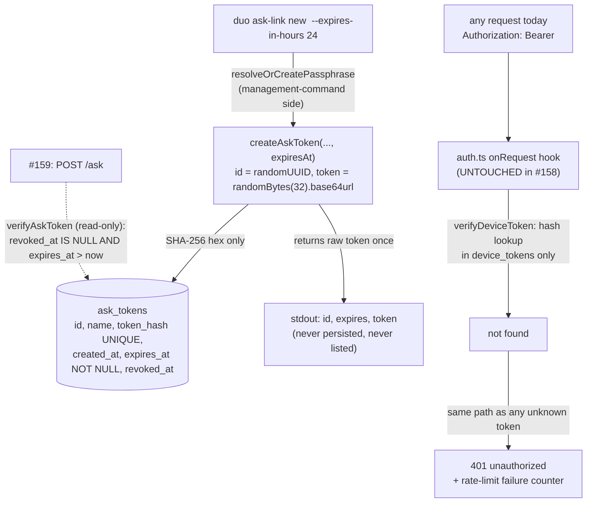

# Ask-Link Tokens Distinct From Device Pairing - Plan

## Goal Capsule

- **Objective:** The owner can mint short-lived, ask-only tokens ("ask links") that will authorize exactly one future capability — posting a question (#159's route) — while every route that exists today refuses them exactly as it refuses an invalid device token. The owner can list every outstanding link with its scope and expiry, and revoke one immediately, all from the CLI.
- **Means:** A second token kind in the serve token layer (`src/serve/tokens.ts`) — a new `ask_tokens` table with a mandatory expiry — minted, listed, and revoked by a `duo ask-link` command group that mirrors `duo pair`, plus a read-only `verifyAskToken` that enforces revocation and expiry and has no write path at all (KTD1-KTD6).
- **Authority hierarchy:** GitHub issue #158's acceptance criteria and out-of-scope list are authoritative over this plan; the two settled decisions below (distinct kind; no audit extension) are authoritative over any implementation convenience. If any unit finds evidence a settled decision cannot work, it reports that — it does not suppress it.
- **Stop conditions:** any of R1-R6 unmet; an ask token authorizing any route that exists today; an ask token creating a `device_tokens` row or appearing in `duo pair list` output; the raw token value persisted anywhere or printed anywhere except once at mint time.
- **Execution profile:** `code`, Standard depth, test-first in all three units (every unit is behavior-bearing).
- **Tail ownership:** the implementer runs the pinned-Node full suite and `npm run typecheck` (Verification Contract) before considering any unit done, and before the shipping gate.

---

## Product Contract

### Summary

Add an ask-token kind to the serve token layer: minted by `duo ask-link new <name> [--expires-in-hours <n>]` with a mandatory expiry (default 24h), shown exactly once at mint, never a `PairedDevice`. `duo ask-link list` shows every link with its scope (`ask`) and expiry plus revoked/expired status; `duo ask-link revoke <id>` is immediate. A read-only `verifyAskToken` resolves a raw token only when unrevoked and unexpired, ready for #159's `POST /ask`. No existing route accepts an ask token — the refusal is byte-identical to an invalid device token because it is structural: the ask token's hash is not in `device_tokens`, and the auth hook is untouched.

### Problem Frame

Issue #158 (child of epic #157) exists because device tokens are long-lived pairing credentials that carry full owner power across every route. There is no way to let someone ask a question without handing them that full credential. #158 delivers the credential half of the fix: a distinct, expiring, ask-only token kind plus its owner-side management CLI. The consuming route is deliberately not here — #159 wires `POST /ask` to `answerPublicly`/`answerSharedDuo` and will let valid device tokens ask too (owner superset); #160 extends the audit log. This plan's refusal criterion ("no other route accepts it") is therefore testable today against every existing route, all of which are owner-only (only `/health` is exempt).

### Requirements

**Minting and one-time display**
- R1. Given the owner runs `duo ask-link new <name>` with optional `--expires-in-hours <n>` (default 24), the command mints a token with an explicit expiry, prints the id, the expiry, and the raw token exactly once in the `duo pair` style ("copy this now"), and the raw value is never persisted anywhere in recoverable form.

**Distinctness from pairing**
- R2. Minting an ask token creates no `device_tokens` row: `duo pair list` output is unchanged (an empty roster still says "No paired devices."), `verifyDeviceToken` never accepts an ask token, and no `PairedDevice` is returned or implied anywhere on the ask-link path.

**Refusal on every existing route**
- R3. Every route that exists today (` /duos`, `/drafts*`, `/review`, `/mirror/*`, `/trust/grid`, `/audit`) refuses an ask token — valid, expired, or revoked — with the same 401 `{error: {code: "unauthorized"}}` body an invalid device token receives on the same route; and nothing in the ask-token path writes, extends, or recreates an expiry ("not silently renewed").

**Verification primitive for #159**
- R4. `verifyAskToken(storePath, passphrase, rawToken)` returns the `AskToken` (id, name, createdAt, expiresAt, revokedAt) only when the hash matches, `revoked_at IS NULL`, and `expires_at` is still in the future; anything else returns `undefined`. It is read-only (no store decrypt-and-rewrite cycle on the verify path) and compares timestamps as ISO-8601 strings, per repo convention.

**Listing**
- R5. `duo ask-link list` prints every ask token with its scope (the literal `ask`), its expiry, and its status — outstanding (`expires <iso>`), `expired <iso>`, or `revoked <iso>` — oldest first, never any token value, with a sensible empty state ("No ask links.").

**Revocation**
- R6. `duo ask-link revoke <id>` takes effect immediately (the very next `verifyAskToken` returns `undefined`); revoking an already-revoked link is a documented no-op, not an error; revoking an unknown id fails loudly with a message naming the id.

### Key Decisions

- **Ask tokens are a distinct token kind alongside `DeviceToken`, not device tokens with a permission flag.** (session-settled: user-directed — chosen over reusing device tokens with a scope column: the pairing table must never carry owner-superset semantics; #159 will let valid device tokens also ask, never the reverse.) Governs R2, R3, and KTD1.
- **No audit-log extension in this issue.** (session-settled: user-directed — chosen over recording mint/list/revoke events now: the audit surface is #160's work, and this issue's ACs need none of it.) Governs Scope Boundaries.

### Scope Boundaries

**Out of scope (per issue #158):**
- Any UI for issuing tokens — CLI only.
- Device tokens themselves, which are unchanged (their table, semantics, and CLI are untouched).

**Deferred to follow-up issues (per #157's declared order):**
- `POST /ask` itself, asker resolution via `directory.json`, and the answerPublicly/answerSharedDuo wiring — all #159.
- Audit-log entries for ask-token lifecycle — #160.
- Any daemon-side consumption of ask tokens (the auth-hook seam that resolves and exposes token kind to routes belongs to #159's diff, per KTD3).

---

## Planning Contract

### Key Technical Decisions

- KTD1. **Ask tokens live in a new `ask_tokens` table in the same encrypted store, added to `src/serve/tokens.ts` alongside the device-token code** (the issue names this file). Schema-on-demand via `ensureAskTokenSchema(db)` called at the top of every ask-token function (no migration step for existing stores), `STRICT`, ISO-8601 TEXT timestamps, `token_hash TEXT NOT NULL UNIQUE`, revoke via `revoked_at`, no mutation triggers (token tables are not logs). Chosen over a sibling `ask-tokens.ts` module: both kinds share the `hashToken`/`withDatabase`/Row-mapper conventions, and #159's route wiring gets a single import site.
- KTD2. **Expiry is mandatory and is the sole limit mechanism — no use-count.** Chosen over a use-count limit: verification stays read-only (`withDatabase(..., false, ...)` — one store decrypt per check, the cost rationale `verifyDeviceToken` already documents), while a use-count forces a write-per-use against the encrypted store and opens a cache-then-consume race in #159. Direct precedent: `src/actions/binding.ts` (`BINDING_ACTION_DEFAULT_EXPIRY_HOURS = 24`, `--expires-in-hours`) and ISO-8601 lexicographic comparison in `approvals.ts`.
- KTD3. **Refusal-by-table-separation: `src/serve/auth.ts` and `src/serve/server.ts` are untouched.** An ask token's hash is not in `device_tokens`, so the existing `onRequest` hook already refuses it byte-identically to an invalid device token on every route — the AC's equivalence is structural, not conditional on new code. Chosen over a kind-aware hook now: kind discrimination has no consumer until #159 opens `POST /ask` (that seam — a resolved principal with kind left visible to routes — is #159's diff), and dead discrimination code in an auth-sensitive path is a liability, not a head start.
- KTD4. **`createAskToken(storePath, passphrase, name, expiresAt)` takes the expiry as an ISO-8601 string**; the default-and-flag arithmetic (`--expires-in-hours`, default 24, must be a positive integer) lives at the CLI edge, mirroring how `actions bind` keeps its user-facing knob. Tests mint already-expired tokens by passing a past date — deterministic, no fake timers (this repo has no fake-timer precedent).
- KTD5. **No `last_seen_at` column on ask tokens in this issue.** Nothing daemon-side consumes it yet; #159's route and #160's audit will add exactly what they need. Device tokens keep theirs, unchanged.
- KTD6. **`verifyAskToken` has no write path at all.** Its predicate is `WHERE token_hash = ? AND revoked_at IS NULL AND expires_at > ?` (now as ISO string). "Not silently renewed" is enforced by absence: verification cannot extend, recreate, or reset anything.

### Assumptions

Recorded per headless-mode routing (no synchronous user to confirm implementation-detail choices):

- Default expiry is 24 hours behind `--expires-in-hours <n>` — the issue says "an expiry (or a use-count limit)" without naming a default; 24h mirrors `BINDING_ACTION_DEFAULT_EXPIRY_HOURS`, the repo's only expiry default.
- `ask-link new` takes a `<name>` argument mirroring `pair new` — a free-form label for whom the link is intended (e.g. "Sam").
- "Scope" in `ask-link list` output is the literal word `ask` — every token in this table shares that scope by construction, so no speculative `scope` column is stored.
- The publishing gate is the pinned-Node local suite plus typecheck (the repo has no CI by design); the suite baseline is 957 passing tests, and this plan adds roughly 15-18.

### High-Level Technical Design

The one behavior that is not obvious from prose: why an untouched auth hook refuses ask tokens *identically* to invalid device tokens, and where #159 will later plug in.

The refusal equivalence is structural: kind is resolved by *which table the hash hits*, never by a prefix or claim in the token value (a visible kind marker would leak kind and break the identical-refusal AC).

---

## Implementation Units

### U1. Ask-token kind in the serve token layer

**Goal:** Extend `src/serve/tokens.ts` with the ask-token kind: `AskToken` and `MintedAskLink` interfaces, `ensureAskTokenSchema`, `createAskToken`, `listAskTokens`, `revokeAskToken`, `AskTokenNotFoundError`, and `verifyAskToken`.

**Requirements:** R1 (mint primitive), R2, R4, R6 (primitive half); KTD1, KTD2, KTD4, KTD5, KTD6.

**Dependencies:** None.

**Files:**
- `src/serve/tokens.ts` — new section after the device-token code, mirroring its shape exactly: `AskTokenRow` + `rowToAskToken` mapper, module-comment paragraph citing issue #158 and the distinct-kind decision, `expires_at TEXT NOT NULL` (KTD2).
- `test/serve-tokens.test.ts` — new `describe("ask links (issue #158)")` block reusing the file's `initStore()` helper.

**Approach:**
1. Mint mirrors `createDeviceToken`: `randomUUID()` id, `randomBytes(32).toString("base64url")` token, SHA-256 hex into `ask_tokens`, and returns `MintedAskLink {id, name, token, expiresAt}` — the raw token exists only in that return value.
2. Revoke mirrors `revokeDeviceToken` exactly: `UPDATE ... SET revoked_at = ? WHERE id = ? AND revoked_at IS NULL`; `changes === 0` distinguishes `AskTokenNotFoundError` (message names the id) from a documented double-revoke no-op.
3. Verify is read-only with the KTD6 predicate; list is read-only, oldest first (`ORDER BY created_at, id`), and its return type carries no token field at all.

**Patterns to follow:** The device-token section of the same file (`DeviceTokenRow`/`rowToToken`, `PairedDevice`, `DeviceTokenNotFoundError`); `approvals.ts` ISO-string expiry comparison.

**Test scenarios:**
- Mints a token that verifies — `verifyAskToken` returns id, name, `expiresAt` — and `JSON.stringify(listAskTokens(...))` does not contain the raw token (no-leak convention).
- `verifyAskToken` rejects an unknown token (`undefined`).
- Rejects a revoked token immediately (mint, revoke, verify → `undefined`).
- Covers the expired AC. Rejects a token minted with a past `expiresAt`; and it is not renewed — `listAskTokens` still shows the original `expiresAt` and a second verify still rejects (no write path exists).
- Covers the distinctness AC. Minting creates no device token: `listDeviceTokens(...)` is empty and `verifyDeviceToken(storePath, passphrase, askToken)` is `undefined`.
- Revoking an already-revoked link is a no-op (`not.toThrow()`).
- Revoking an unknown id throws `AskTokenNotFoundError` with the id in the message.
- Lists oldest first.

**Verification:** Red first — before implementation the new describe block fails to compile (`createAskToken` absent), which is the unit's red evidence. Then `PATH="$HOME/.nvm/versions/node/v22.22.3/bin:$PATH" npx vitest run test/serve-tokens.test.ts` green.

---

### U2. `duo ask-link` command group

**Goal:** The owner-facing surface: `runAskLink`/`runAskLinkList`/`runAskLinkRevoke` in `src/commands/serve.ts` and an `askLinkCommand` group in `src/cli.ts`, mirroring the `pair` trio.

**Requirements:** R1, R5, R6 (CLI surface); KTD4.

**Dependencies:** U1.

**Files:**
- `src/commands/serve.ts` — the three functions beside `runPair`/`runPairList`/`runPairRevoke`, each `requireStoreExists` → `resolveOrCreatePassphrase` → store call, with `env: NodeJS.ProcessEnv = process.env` injection; the existing management-commands comment block above `runPair` already covers ask-link (same side of the passphrase-resolution line).
- `src/cli.ts` — `askLinkCommand = program.command("ask-link")` with `new <name> [--expires-in-hours <n>]`, `list`, `revoke <id>`, mirroring `pairCommand` (lines ~128-177).
- `test/ask-link-cli.test.ts` — new file mirroring `test/pair-cli.test.ts` (subprocess `runCli`, `DUO_STORE_PATH` env, id-scraping regex).

**Approach:**
1. `--expires-in-hours` uses `parseIntegerOption` for parsing, then validates strictly positive at the action boundary — `0` or negative must exit non-zero naming the flag, since it would mint an already-dead link. The action computes `expiresAt = new Date(Date.now() + hours * 3_600_000).toISOString()` (KTD4).
2. `new` prints id, `Expires <iso>`, then the pair-convention line "Token (copy this now, it will not be shown again):" and the raw token on its own stdout line. `list` prints `[id] name — ask · expires <iso>` / `... — ask · expired <iso>` / `... — revoked <iso>`, or "No ask links." `revoke` prints `Ask link <id> revoked.` Errors flow through `reportError` (stderr, exit 1).

**Patterns to follow:** `pairCommand` registration and output in `src/cli.ts`; the `runPair` trio in `src/commands/serve.ts`; `actions bind --expires-in-hours` for the expiry flag.

**Test scenarios:**
- `ask-link new "Sam"` exits 0; stdout contains "Sam", an `Expires` line, and the copy-now token line; the id is scrapeable (`/id ([\w-]+)/`).
- `ask-link list` afterwards shows Sam with both `ask` and `expires` (scope + expiry AC).
- Covers the pair-list AC. After minting an ask link, `pair list` still prints "No paired devices."
- `ask-link list` never prints the raw token (mint, capture token from stdout, assert absent from list stdout).
- `ask-link revoke <id>` exits 0; `ask-link list` then shows `revoked`.
- `ask-link revoke not-a-real-id` exits non-zero; stderr contains `not-a-real-id`.
- `ask-link new "Sam" --expires-in-hours 0` exits non-zero naming `--expires-in-hours` (and likewise a negative value).
- `ask-link list` on a fresh store prints "No ask links."

**Verification:** Red first (`ask-link` is an unknown command before wiring). Then pinned-Node `npx vitest run test/ask-link-cli.test.ts` green.

---

### U3. Route-level refusal — characterization tests

**Goal:** Pin R3 with server-level tests against the untouched auth hook: an ask token — valid, expired, or revoked — is refused on owner-only routes byte-identically to an invalid device token.

**Requirements:** R3; KTD3.

**Dependencies:** U1.

**Files:**
- `test/serve-server.test.ts` — new tests inside the existing `createServer — auth` describe (reusing its `beforeEach` store/app and `deps()` helper).

**Approach:**
1. Pure test addition; no production change (KTD3). Mint via `createAskToken` directly (fresh token; one with a past `expiresAt`; one revoked), then `app.inject` GETs with `Authorization: Bearer <askToken>` against `/duos`, `/drafts`, `/review`, `/mirror/portrait`, `/trust/grid`, and `/audit` — every route family R3 enumerates — asserting 401 with `{error: {code: "unauthorized"}}` and the same body an invalid device token gets.
2. Keep every test under 10 auth failures: the rate-limit window is per-IP and shared across kinds, and all `app.inject` calls originate from 127.0.0.1 on one app instance. Six routes plus one invalid-device-token comparison is seven injects per scenario — compare the invalid-device-token body once (the hook rejects before routing, so the refusal body is route-independent), never once per route, and keep the three token states as three separate tests with the describe's fresh-app `beforeEach`.

**Patterns to follow:** The existing auth describe's inject style; the revocation-within-TTL test (line ~80) as the precedent for hook-behavior pinning.

**Test scenarios:**
- Covers the refusal AC. A fresh, valid ask token gets 401 `{error: {code: "unauthorized"}}` on `/duos`, `/drafts`, `/review`, `/mirror/portrait`, `/trust/grid`, and `/audit` — the identical status and body shape as a request bearing a known-invalid device token (compared once; the hook rejects before routing, so the body is route-independent).
- An expired ask token is refused the same way (the hook does not distinguish; nothing renews it).
- A revoked ask token is refused the same way.

**Verification:** Red first pre-U1 (`createAskToken` absent — compile failure); green with zero production-code change in this unit. Pinned-Node `npx vitest run test/serve-server.test.ts` green, and `git diff origin/main --stat -- src/serve/auth.ts src/serve/server.ts` is empty (KTD3 made checkable).

---

## Verification Contract

All commands run with `PATH="$HOME/.nvm/versions/node/v22.22.3/bin:$PATH"` (pinned Node for `node:sqlite` + FTS5; the default system Node will not run this suite).

| Command | Applies to | Gate |
|---|---|---|
| `npx vitest run test/serve-tokens.test.ts test/ask-link-cli.test.ts test/serve-server.test.ts` | U1-U3 | Every listed scenario passes |
| `npx vitest run --testTimeout=60000` | All units, shipping gate | Full suite green — 957 baseline plus the new tests, zero failures (the timeout flag is local machine-load resilience, not a repo change) |
| `npm run typecheck` | All units, shipping gate | `tsc --noEmit` zero errors |
| `git diff origin/main --stat -- src/serve/auth.ts src/serve/server.ts` | U3, KTD3 | Empty — auth and server untouched |
| `git grep -n "pair" src/cli.ts \| grep -c askLink` (or equivalent inspection) | U2 | `ask-link` is a separate group; no `pair` handler gained ask behavior |

## Definition of Done

**Global:**
- Every acceptance criterion of #158 has a passing test: mint with expiry + one-time display (R1), no `PairedDevice`/pair-list presence (R2), identical refusal on every existing route for valid/expired/revoked ask tokens with no renewal path (R3), read-only verify primitive (R4), list with scope and expiry (R5), immediate revoke with loud unknown-id failure (R6).
- The raw ask-token value exists only in the mint return value and the single stdout line; it is absent from every list output and every stored column (asserted by the no-leak tests).
- `src/serve/auth.ts` and `src/serve/server.ts` are byte-identical to `main` (KTD3).
- No dead-end code from abandoned approaches remains in the diff; no audit-log writes were added (settled decision 2).

**Per unit:**
- U1: ask-token describe block green, including distinctness and not-renewed scenarios.
- U2: `ask-link` CLI scenarios green, including the positive-hours validation and pair-list isolation.
- U3: refusal characterization green against all six owner-route families R3 enumerates (`/duos`, `/drafts`, `/review`, `/mirror/*`, `/trust/grid`, `/audit`) with identical-body assertions; zero production diff in this unit.
