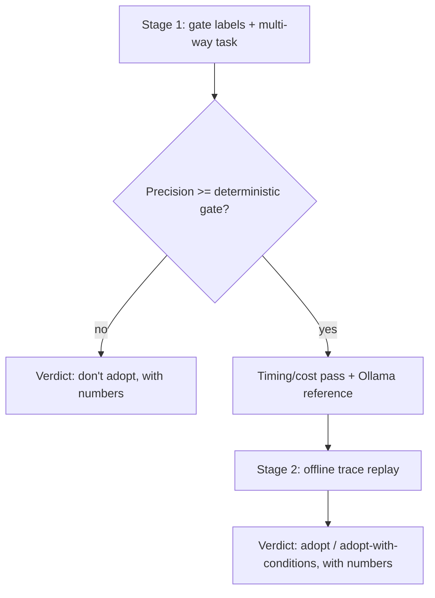
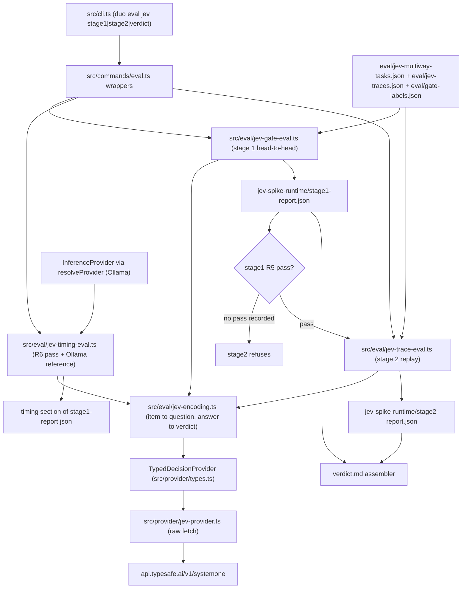
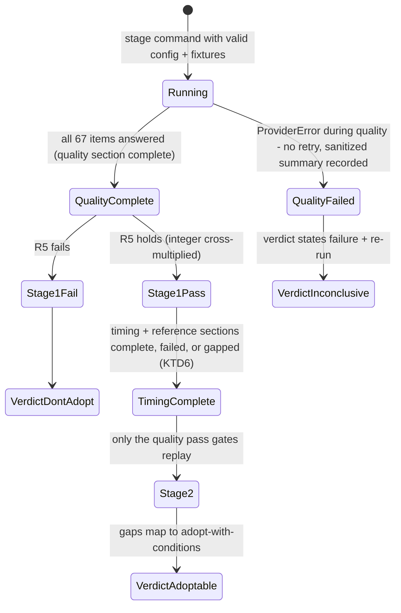

# Jev Typed-Decision Spike - Plan

## Goal Capsule

- **Objective:** The owner can decide, from one written report with numbers, whether Jev — TypeSafe AI's System One typed-decision model — should make decisions in the duo.
- **Means:** A staged spike. Stage 1 scores Jev against the deterministic drafting relevance gate on existing hand labels plus a hand-authored multi-way task. Stage 2, only if quality clears, replays authored navigation traces offline (KTD3–KTD6 carry the interface, encoding, and staging mechanics).
- **Product authority:** Dialogue of 2026-09-20; every framing decision is session-settled and annotated in Key Decisions.
- **Open blockers:** None. The three questions the Product Contract deferred to planning are resolved (Outstanding Questions records where).
- **Stop conditions:** Stage 1 precision below the deterministic gate's ends the spike at the verdict; stage 2 never runs. A provider-failed quality section ends inconclusive — no verdict is emitted without its numbers; timing or reference failures degrade to gaps, not inconclusiveness (KTD6, KTD7).
- **Execution profile:** Spike code ships tested with fakes; the hosted run itself is owner-executed with `DUO_JEV_API_KEY`. The repo has no CI, so zero-egress is enforced inside the suite itself — a vitest setup file denies all unstubbed non-loopback network access, with loopback left open for the existing serve test (KTD10, Verification Contract).

---

## Product Contract

Product Contract preservation: unchanged; the three planning-deferred questions resolved into KTD1, KTD4, and KTD11. No R/A/F/AE was added, removed, or reworded.

### Summary

A staged, measurement-first spike that decides whether Jev earns a place in the duo's decision paths. Stage 1 scores it head-to-head against the deterministic relevance gate on the gate's own hand labels, plus a hand-authored multi-way decision task. Stage 2, conditional on clearing the quality bar, has Jev navigate authored traces offline — no browser automation. Jev sits behind a new parallel typed-decision interface throughout, so the whole footprint is removable as one unit.

### Problem Frame

The duo's roadmap includes answering questions that require going out and using the owner's tools — a browser, search — to find or execute. Each step of such a loop is a small decision: which candidate action next. A frontier LLM per step is the slow, expensive shape for that. Jev is billed as the fix — typed choices and probabilities in one parallel pass, 70–500 ms, at a fraction of LLM cost — but none of that is measured for this codebase.

There is also nothing to swap. Every action-gate decision in the repo — tiering (`src/actions/registry.ts`), the T4 guard, reversibility, approvals — is deterministic rules by documented design, and the one inference abstraction (`src/provider/types.ts`) is text-in/text-out. The question is not "replace an LLM judgment" but whether fast typed judgment earns a place at all — and the tool-use loop it would serve does not exist yet. A measured verdict has to come before any loop work starts.

### Requirements

**Typed-decision interface**

- R1. The spike adds a typed-decision provider interface parallel to `InferenceProvider`: input is decision state plus typed questions; output is choices, scores, or probabilities. Decisions never route through `complete()`.
- R2. One adapter implements that interface against hosted Jev through a gateway. No code outside the adapter knows Jev's protocol; removing adapter plus interface removes the spike's entire Jev footprint.

**Stage 1 — decision quality**

- R3. Stage 1 runs Jev over the drafting relevance gate's hand-labelled set (`eval/gate-labels.json`, 47 synthetic entries) and reports precision and recall separately, head-to-head with the deterministic gate (`classifyMention`) on the same labels. Never one averaged figure.
- R4. Stage 1 also runs a hand-authored multi-way task — candidate-action sets with one known correct pick each — testing menu-picking, the shape navigation needs, not only binary relevance.
- R5. The quality gate is relative: stage 1 passes only if Jev's precision on R3's labels is at least the deterministic gate's precision on the same labels.
- R6. Only after R5 passes does the spike measure and report speed and cost per decision — milliseconds and dollars — including an Ollama reference run answering the same questions, since no Ollama path runs these decisions today.

**Stage 2 — conditional navigation replay**

- R7. Stage 2 runs only if R5 passed. It replays hand-authored navigation traces offline — each step is page state, a candidate-action set, and the correct next action — with no browser automation, and reports per-step accuracy and whole-trace completion.
- R8. Traces are checked-in synthetic fixtures, reusable later as regression fixtures for real navigation work.

**Data handling**

- R9. Everything sent to the hosted gateway is synthetic: the gate labels, the multi-way tasks, the traces. No owner or user content leaves the machine. The G1 local-only default for production paths is unchanged.

**Verdict**

- R10. The spike ends in a written verdict — adopt, adopt-with-conditions, or don't adopt — with the measured numbers attached, readable without re-running anything.

### Key Decisions

- **Staged verdict, gate before navigation** (session-settled: user-directed — chosen over a navigation-only spike: a failure must be attributable to the model, not the loop). Governs R3, R5, R7.
- **Offline trace replay over a live browser loop** (session-settled: user-directed — chosen over a minimal live loop: isolates judgment from automation noise, and traces double as fixtures). Governs R7, R8.
- **A new parallel typed-decision interface** (session-settled: user-directed — chosen over shoehorning into `complete()` or resolving G1 now: Jev's state-plus-questions shape is the point, and the local-only stance stays untouched). Governs R1, R2, R9.
- **Multi-way task in stage 1** (session-settled: user-directed — chosen over binary-only labels: menu-picking is the capability being bought). Governs R4.
- **Quality-gated success bar** (session-settled: user-directed — chosen over quality-only or speed/cost-first readings: cost only matters once quality clears). Governs R5, R6.
- **Hosted egress accepted for the spike, synthetic content only** (session-settled: user-directed — chosen over a local-only hard line or a review-then-send step: the label set is verified synthetic, and production paths keep G1). Governs R9.
- **Relative precision bar over an absolute floor** (session-settled: user-approved — proposed with the hard 0.95-floor alternative surfaced and the synthesis confirmed: the deterministic gate on the same labels is the honest comparator). Governs R5.

### Key Flows

- F1. Stage-1 verdict run
  - **Trigger:** The owner runs the stage-1 eval.
  - **Steps:** Load labels and multi-way tasks; call the Jev adapter per item with state and typed questions; score precision and recall against the deterministic gate on the same items; if R5 passes, run the timing/cost pass including the Ollama reference; emit the report.
  - **Outcome:** A stage-1 report with separate precision and recall, plus timing/cost if earned.
  - **Covers R3, R4, R5, R6.**
- F2. Stage-2 replay
  - **Trigger:** Stage 1 passed R5.
  - **Steps:** Load traces; replay each step with Jev ranking the candidate actions; record the top pick and full ranking; a wrong top pick marks the step wrong without halting the trace.
  - **Outcome:** Per-step accuracy and trace-completion numbers feeding the verdict.
  - **Covers R7, R8, R10.**

The stage gating those flows implement:



### Acceptance Examples

- AE1. **Covers R3, R5.** Given the 47-label set, when Jev's precision lands below the deterministic gate's, then the run reports the failure, stage 2 never runs, and the verdict records don't-adopt with the numbers.
- AE2. **Covers R5, R6.** Given Jev's precision at or above the gate's, when the timing/cost pass runs, then per-decision milliseconds and dollars and the Ollama reference numbers appear in the same report.
- AE3. **Covers R7, R8.** Given a trace whose correct step-4 pick is the third candidate, when replay reaches step 4, then Jev's full ranking is recorded; a wrong top pick marks the step wrong and replay continues.

### Scope Boundaries

- No live browser or tool automation; navigation is offline trace replay only.
- No production wiring: no duo path, action gate, or drafting call invokes Jev; the action registry and gates are untouched.
- G1 stays unresolved; hosted inference is a spike-only exception recorded here, not a precedent.
- The real tool-use loop — the duo driving the owner's tools — is future work with its own brainstorm, even if the spike passes.
- No tuning of Jev beyond encoding the tasks; this is a first read, not an optimization pass.

#### Deferred to Follow-Up Work

- Batching multiple questions into one Jev call as a cost lever — deliberately unmeasured; per-decision calls are the shape being bought. The interface already accepts a question list (KTD4), so this follow-up extends call sites without breaking the seam.
- Adapter work for OpenAI-compatible gateway envelopes (Requesty, OpenRouter) — only relevant if direct access is unobtainable (KTD1, Risks).

### Dependencies / Assumptions

- Assumption: gateway access (account, key) is obtainable; resolved for planning as direct TypeSafe API access, key from console.typesafe.ai (KTD1). Waitlist risk recorded under Risks.
- Assumption: Jev's documented API shape — program state plus typed questions answered in one parallel pass — holds; verified against the official API reference at planning (Sources). Vendor performance claims (40–200× faster, 40–400× cheaper) are treated as unverified and measured, not trusted.
- Dependency: the existing eval harness pattern (`src/eval/gate-eval.ts`: hand labels, separate precision/recall, loud floor failure) is the shape stage 1 copies.
- Dependency: the owner holds `DUO_JEV_API_KEY` at run time; the checked-in test suite never needs it.

### Outstanding Questions

None blocking. The three questions deferred to planning are resolved: hosted route (KTD1), typed-question encoding (KTD4), fixture sizes (KTD11). Three items remain verify-at-implementation, not plannable now: Jev's undocumented caps (state size, questions per call, rate limits); the exact error bodies on 401/422/429/529; and whether a `choice` answer's `probabilities` cover the full criteria map or only a top-k subset — F2 and AE3 record full rankings from one choice answer (KTD4), so a top-k-only field would force an encoding amendment mid-implementation. All land as adapter behavior confirmed on first live run, with fallbacks noted in Risks.

### Sources / Research

- `src/provider/types.ts` — text-in/text-out interface and the rule that no call site outside `src/provider` issues inference directly; `EmbeddingProvider` (`types.ts:20-27`) is the sibling-interface precedent KTD3 follows, and `ProviderConfigError`/`ProviderError` (`types.ts:36-60`) are the error taxonomy the Jev adapter reuses.
- `src/provider/ollama-provider.ts` — raw-fetch, no-SDK convention, timeout, and the three failure paths (unreachable / non-2xx / bad shape) the Jev adapter replicates.
- `src/eval/gate-eval.ts`, `src/eval/gate-labels.ts`, `eval/gate-labels.json` — the eval pattern stage 1 copies; labels hand-made, 47 synthetic entries, no real personal data. Precision is 1 when nothing is predicted positive (`gate-eval.ts:71`).
- `src/drafting/relevance-gate.ts` — `RELEVANCE_GATE_TARGET_PRECISION = 0.95`; the absolute floor this plan deliberately does not reuse (relative bar per the last Key Decision).
- `src/config.ts:60,63` — `DEFAULT_EVAL_GATE_LABELS_PATH` and `DEFAULT_EVAL_GATE_PRECISION_FLOOR`, the config pattern for the new fixture paths and price constant.
- `docs/implementation-plan.md:46` — G1 default: local-only via Ollama, behind the abstracted provider.
- `src/actions/registry.ts` — deterministic tiering and outright refusal of unregistered actions; the reason no action gate is in scope for model decisions.
- `test/action-registry.test.ts` — the only tier-classification ground truth in the repo; not reused by stage 1 because tier assignment is a settled deterministic rule, not an open model decision.
- `test/provider.test.ts:91-173` — the `vi.stubGlobal("fetch")` adapter-test pattern; `test/eval-cli.test.ts` — the CLI-test pattern including malformed-fixture coverage; `src/drafting/confidence.ts:122-133` — the timing-measurement precedent.
- Verified at planning by running `scoreRelevanceGate`: the deterministic gate scores precision 1.000, recall 1.000 on the current 47 labels (12 TP / 0 FP / 35 TN / 0 FN), with no `duo/refusals.md` present. KTD8 carries what that implies for R5.
- External, verified against primary docs 2026-09-20: TypeSafe quickstart and API reference (docs.typesafe.ai — `/v1/systemone` endpoint, `state`/`model`/`questions` request, `choice`/`score`/`noul` question types, `answers`+`usage` response, 401/422/429/529 errors), JS SDK docs (`@typesafe-ai/sdk` — exists, not used per KTD2), Requesty's Jev guide (OpenAI-compatible envelope, "experimental, may change without deprecation"), LangChain's harness guide (choice/ranking precedent; Jev never generates text), OpenChamber's tweet survey (median 76 ms across 333 API requests; user-reported ~30× cost reduction and ~7× speedup — well under vendor headline claims, supporting the measure-don't-trust stance). Billing: $0.042/MTok input, output free.

---

## Planning Contract

### Key Technical Decisions

- KTD1. **Hosted route is TypeSafe's direct API** (`https://api.typesafe.ai/v1/systemone`, Bearer key). Chosen over Requesty/OpenRouter gateways: the direct endpoint is the canonical contract the official SDK documents, while gateway envelopes are explicitly experimental and would couple the spike to a shifting protocol. Instantiates the hosted-egress Key Decision (session-settled: user-directed — chosen over a local-only hard line or a review-then-send step: the label set is verified synthetic, and production paths keep G1). Governs R2, R9.
- KTD2. **Raw `fetch`, no SDK.** `@typesafe-ai/sdk` exists, but the provider layer's settled convention is raw fetch with the three-tier `ProviderError` taxonomy (`src/provider/ollama-provider.ts`); staying raw also keeps the adapter removable as one unit with zero dependencies. Cites R2.
- KTD3. **`TypedDecisionProvider` modeled on `EmbeddingProvider`** — a sibling interface in `src/provider/types.ts`, one adapter (`src/provider/jev-provider.ts`) with a `createJevProvider(config)` factory, and deliberately no registry entry: single implementation, unconditional within the spike, same reasoning as `types.ts:20-27`. Instantiates the parallel-interface Key Decision (session-settled: user-directed — chosen over shoehorning into `complete()` or resolving G1 now: Jev's state-plus-questions shape is the point, and the local-only stance stays untouched). Governs R1, R2.
- KTD4. **Question encoding: binary questions for labels, choice questions for multi-way and trace steps; one call per decision; neutral interface vocabulary.** The interface speaks neutral terms (binary/choice questions and answers); only `src/provider/jev-provider.ts` maps them to Jev's wire types (`noul`, `choice`), so R2's "no code outside the adapter knows Jev's protocol" holds by construction. Each label/task/trace-step becomes exactly one call whose `state` is that item's synthetic content and whose single question is a binary ("is this a genuine question the owner would answer?") or a choice (criteria map = candidate actions). The interface accepts a question list and returns parallel answers — every spike call site passes exactly one — so the deferred batching follow-up extends call sites instead of breaking the seam. Per-decision ms/$ stay honest (per HTTP call), and state stays tiny against undocumented caps. Resolves the deferred schema question. Cites R1, R3, R4, R7.
- KTD5. **Stage reports persist to a configurable gitignored runtime dir; stage gating is enforced in code.** `duo eval jev stage1` writes `stage1-report.json` under the runtime dir (config key with default `jev-spike-runtime/`, env `DUO_JEV_SPIKE_RUNTIME_DIR` — the `lifecycleLogPath`/`duo-lifecycle-runtime/` precedent, env-overridable the same way; tests point it at temp dirs so nothing writes into the repo); `stage2` refuses to run without a persisted passing stage-1 quality verdict; `duo eval jev verdict` assembles `verdict.md` from the persisted reports. Reports record the effective gateway origin and a content hash of the fixture files they ran. This deliberately breaks the eval commands' stdout-only convention because R7's "only if R5 passed" and R10's "readable without re-running" both need durable state. Governs R7, R10.
- KTD6. **Run state is recorded per section, not implied.** The stage-1 report carries `quality`, `timing`, and `reference` sections, each `complete`, `failed`, or `gap` with a reason — a 429 during a timing call must not erase an earned R5 pass, and a missing Ollama model must not strand it. Stage 2's gate reads only the quality section's R5 verdict. The repo's no-retry fail-loud convention stands — one transient 429 fails its section — but the failure is recorded as a sanitized summary (error class and status, never a raw response body, per KTD10's redaction rule), so the verdict command states "inconclusive — provider failure, re-run" only when the quality section itself failed. A failed run is not a don't-adopt, and the inconclusive outcome is a run-state statement rather than one of R10's three verdicts — R10's enumeration covers runs whose quality section completed. Cites R10.
- KTD7. **Verdict text is generated with its honesty guards built in.** The verdict template states: the comparator's actual precision and its zero-FP implication (KTD8); how many of the 47 Jev marked answerable (a degenerate all-negative run passes R5's letter with precision 1 — the number makes that visible at a glance); multi-way accuracy and stage-2 numbers as headline rows, since R5's gate covers only the binary labels; the response's `model` field, run date, and effective gateway origin. Timing or reference gaps map to adopt-with-conditions rather than blocking the verdict; a stage-2 failure after a quality pass yields the stage-1 numbers plus "navigation unknown". The assembler builds exclusively from the reports' aggregate fields — never raw error text — so `verdict.md` is safe to promote into `docs/` by construction. Cites R5, R10.
- KTD8. **The relative bar is integer-exact and its sharp edge is disclosed.** R5's comparison uses cross-multiplied integer counts (`tpJev·(tpGate+fpGate) ≥ tpGate·(tpJev+fpJev)`), never float division. Conflict call-out on the settled relative bar: the comparator scores a verified 1.000 on the 47 labels (12 positives; the gate was iterated against this set until perfect), so on this label set any precision bar at or above 0.9231 — the relative bar and the rejected 0.95 floor alike — requires zero false positives; one FP ends in don't-adopt, against a comparator with home-field advantage while Jev is untuned by the plan's own scope boundary. The decision stands as settled — it works as decided and remains the honest comparison — and the verdict must present the numbers with exactly this framing so a don't-adopt reads as what it is: a first read that missed zero-FP precision on a tuned comparator's home set. Governs R5.
- KTD9. **Ollama reference: strict prompts, wrong-not-aborted parsing, degrade to a reported gap.** The reference asks each binary/multi-way question through `complete()` on `config.ollama.model` with an "answer with exactly one option id" instruction; output that doesn't match an option id exactly (after trim) counts wrong and is tallied separately as a parse failure. The reference degrades to a named gap on any `ProviderConfigError` (naming its key — `DUO_PROVIDER` when no provider is configured at all, `DUO_OLLAMA_MODEL` when the model is unset) or any reference-path `ProviderError` (e.g. Ollama unreachable), so stage 1 still completes and the verdict records the gap rather than stranding the earned quality numbers. The reference reports accuracy and parse-failure rate only; R6's per-decision milliseconds and dollars attach to Jev's measured calls, never to the reference. Cites R6.
- KTD10. **Refusal parity without egress; R9 auditable at two files and enforced in the suite.** The baseline `classifyMention` runs with the owner's real local refusals (`readRefusalsFile`, exactly as `runEvalGate` does); Jev never receives them. The report prints the loaded-refusal count and a parity caveat whenever it is non-empty (today the file is absent and the count is 0). R9's construction half lives in `src/eval/jev-encoding.ts`: state, instructions, and criteria are composed exclusively from fixture fields and module-level string constants — no `DuoConfig` value, filesystem read, or store/refusal content may enter request construction (an env-overridden `DUO_OWNER_NAME` must never ride along in question text). The transport half lives in `src/provider/jev-provider.ts`, whose module doc comment pins the same rule. Enforcement: a vitest setup file makes unstubbed non-loopback `fetch` throw — requests to `127.0.0.1`, `::1`, or `localhost` pass, because `test/serve-cli.test.ts` exercises a real loopback server and loopback cannot leave the machine — so the suite cannot egress even with `DUO_JEV_API_KEY` exported in the owner's shell; request-body audits are exact deep-equality assertions, plus a canary test running with `DUO_OWNER_NAME` set to a marker string asserted absent from every body. The adapter truncates and scrubs error bodies of the key value before any `ProviderError` message, so the key can reach neither stderr, persisted reports, nor the verdict. Cites R3, R9.
- KTD11. **Fixture sizes: 20 multi-way tasks (4–6 candidates each, one correct pick); 8 traces of ~5 steps (~40 replay decisions).** Matched to hand-authoring cost and to a readable verdict: each multi-way item is 5%, each trace 12.5%. Resolves the deferred sizing question. Cites R4, R7, R8.

### High-Level Technical Design

Component and data flow — everything Jev-touching lives in `src/provider/`; everything stage-shaped lives in `src/eval/`; `src/cli.ts` only wires:



Run lifecycle — a run ends in exactly one of three states, and only `complete` feeds a verdict:



Request encoding, one decision per call (directional, not an implementation spec):

```text
binary label i:   state = { mention: labels[i].text }
                  question = binary { instructions: "genuine question the owner would answer?" }
                  answer.probability >= 0.5  -> answerable   (exactly 0.5 -> not answerable, KTD/Assumptions)

multi-way item:   state = { scenario, goal }
                  question = choice { criteria: { candidateId: description, ... } }
                  answer.pick == expected -> correct;  answer.pick not in criteria -> wrong (recorded)

trace step:       state = { pageState, goal, history so far }
                  question = choice over candidate actions; full ranking recorded (AE3)

wire mapping (adapter-only, KTD4): binary -> noul, choice -> choice
```

### Assumptions

Un-validated planning bets (pipeline run — no synchronous user confirmed these):

- A `noul` answer of exactly 0.5 breaks to "not answerable", matching the gate's precision-first, prefer-silence asymmetry.
- The generated verdict living in `jev-spike-runtime/verdict.md` satisfies R10; promoting it into `docs/` is the owner's copy-paste, not spike machinery.
- Jev's undocumented caps (state size, questions per call, rate limits) are benign at this spike's scale — roughly 67 quality calls plus ~68 timing calls (67 measured plus one warmup) in stage 1, and ~40 stage-2 calls, each with small state. First live run verifies; Risks records the fallback.
- Input-only pricing at $0.042/MTok holds for the spike's lifetime; it lives in an env-overridable config constant so a change is a setting, not a code edit.
- Direct TypeSafe access will be granted (or already granted) when the owner runs the spike; the code path is identical either way, and a 401 at run time lands in the KTD6 inconclusive state rather than a false don't-adopt.

### Risks and Dependencies

- **One FP ends the spike** (KTD8): with 12 positives, any FP caps Jev precision at 12/13 ≈ 0.923 — below both the comparator's 1.000 and the 0.95 floor. Mitigation is disclosure, not bar movement: the verdict presents the zero-FP requirement and the comparator's tuned-to-this-set history before the number.
- **Waitlisted direct access** (Assumptions): a 401 at run time produces the KTD6 inconclusive state. Escape route is gateway-adapter work, deliberately deferred (Scope Boundaries) because envelopes are experimental.
- **Undocumented caps surface as 422**: fall back to splitting the multi-way criteria map or chunking traces at implementation only if the error body names a cap; record what was hit in the run report. Never silently shrink the fixture set.
- **Ollama reference parse failures** (KTD9): expected, counted, reported — a high parse-failure rate is itself a finding about coercing text models into typed decisions, and the verdict says so rather than hiding it inside accuracy.
- **Comparator home-field advantage**: the gate was iterated against these labels until perfect (recent relevance-gate fixes). The head-to-head is still the settled comparison; the verdict framing (KTD7/KTD8) carries the caveat so the owner reads the number in context.
- **A first shipped off-machine channel** (posture change, stated plainly): today the repo has zero non-localhost egress; after this spike it has an adapter plus an env key that sends content off-machine with no code change. That is the session-settled R9 exception, scoped to synthetic content and owner-executed runs — and it is why KTD10's controls (enforced zero-egress suite, key redaction, two-file audit) ship with the spike rather than as cleanup.

Dependencies: none new at plan level — the spike adds no package dependencies (KTD2) and reuses the existing config, eval, and CLI machinery.

---

## Implementation Units

### U1. Typed-decision interface, Jev adapter, and config

- **Goal:** The removable one-unit Jev footprint: `TypedDecisionProvider` interface, one raw-fetch adapter against `/v1/systemone`, and the config keys that feed it.
- **Requirements:** R1, R2, R9 (KTD1, KTD2, KTD3, KTD10).
- **Dependencies:** none.
- **Files:**
  - `src/provider/types.ts` — add `TypedDecisionProvider` beside `EmbeddingProvider`
  - `src/provider/jev-provider.ts` — new
  - `src/config.ts` — add `jev: { gatewayUrl, apiKey, inputPricePerMTok, runtimeDir }` (env `DUO_JEV_GATEWAY_URL`, `DUO_JEV_API_KEY`, `DUO_JEV_INPUT_PRICE_PER_MTOK`, `DUO_JEV_SPIKE_RUNTIME_DIR`; defaults `https://api.typesafe.ai`, undefined, 0.042, `jev-spike-runtime/`) and `eval.jevMultiwayTasksPath` / `eval.jevTracesPath` (defaults `eval/jev-multiway-tasks.json`, `eval/jev-traces.json`)
  - `vitest.config.ts` — register a setup file
  - `test/setup/network-denial.ts` — new: default `globalThis.fetch` throws for non-loopback requests only (`127.0.0.1`/`::1`/`localhost` pass, so `test/serve-cli.test.ts`'s real `/health` roundtrip keeps running); the setup file's doc comment states that egress rationale; tests override via the existing `vi.stubGlobal` pattern
  - `test/jev-provider.test.ts` — new
- **Approach:**
  - Interface speaks neutral vocabulary — a decision state object plus a list of typed questions (`binary` or `choice` with its criteria map), returning parallel neutral answers with probabilities, confidence, the response's `model` field, and `usage`. Every spike call site passes exactly one question (KTD4's arity rule); only the adapter knows Jev's wire types.
  - Adapter mirrors `ollama-provider.ts`: `AbortSignal.timeout`, factory-thrown `ProviderConfigError("DUO_JEV_API_KEY")`, and the failure paths — unreachable, non-2xx, 2xx with bad JSON or wrong shape — as `ProviderError`. Non-2xx bodies are truncated and scrubbed of the configured key value and any `Authorization` content before entering the message; the factory rejects a non-`https` gateway URL (KTD10).
  - The adapter's module doc comment states the egress boundary: `state` receives fixture-derived synthetic strings only, never `readRefusalsFile` output or any store content (KTD10).
- **Patterns to follow:** `src/provider/ollama-provider.ts` (fetch shape, error taxonomy); `src/provider/ollama-embedding-provider.ts` (adapter without registry); `src/config.ts` eval-block style.
- **Test scenarios:**
  - Happy path: stubbed `fetch` returning a well-formed `systemOne` response — answers, probabilities, model, and usage surface through the interface.
  - Missing `DUO_JEV_API_KEY` → `ProviderConfigError` naming the key, before any request.
  - Non-`https` gateway URL → `ProviderConfigError` at factory time.
  - Unreachable gateway (fetch rejects) → `ProviderError` with "unreachable" wording.
  - Non-2xx whose body contains the configured key value → `ProviderError` carries status and a truncated body that does not contain the key.
  - 2xx with malformed JSON or missing `answers` → `ProviderError` with unexpected-shape wording.
  - Egress audit: the serialized request body deep-equals the expected fixture-derived payload (exact equality, not containment) — extra fields or interpolated values fail.
  - Registry guard: `defaultRegistry` keys remain exactly `["ollama"]` — Jev is never produced by `resolveProvider`, preserving KTD3's structural G1 guarantee.
- **Verification:** `test/jev-provider.test.ts` green under the full suite with the network-denial setup active (an unstubbed non-loopback `fetch` fails loudly); no network primitive (`fetch`, `http`/`https`/`undici`/`WebSocket`) appears outside `src/provider/` — enforced by the structural scan suite test in U4's `test/gitignore.test.ts` extension, not a manual grep.

### U2. Fixtures and loaders

- **Goal:** The hand-authored synthetic multi-way tasks and navigation traces, checked in with fail-loud loaders.
- **Requirements:** R4, R8 (KTD11).
- **Dependencies:** U1 (config paths).
- **Files:**
  - `eval/jev-multiway-tasks.json` — new, object root `{ provenance, items }`, 20 items: scenario, goal, 4–6 candidates (id + one-line description), one `correct` candidate id
  - `eval/jev-traces.json` — new, same object-root shape, 8 traces × ~5 steps: trace id, goal, per-step page state (synthetic), candidate actions, correct action id
  - `src/eval/jev-fixtures.ts` — new loaders
  - `test/jev-fixtures.test.ts` — new
- **Approach:**
  - Loaders copy `gate-labels.ts` exactly: validate the whole `items` array up front; throw a named error citing the offending index or duplicate id; no silent drops.
  - Content is synthetic workplace-navigation material (search-result pages, link menus, form choices) authored by hand alongside the tests, not generated.
  - Provenance is declared, not assumed: JSON files cannot carry comment headers, so each fixture's root is an object whose `provenance` field states the file is synthetic-only, egress-eligible, and never a home for real traces; loader doc comments repeat it, and real navigation traces from later work go to a different path — never these egress-audited files (KTD10, R8).
  - Loaders expose a content hash of each file so persisted reports record exactly what they ran (KTD5).
- **Patterns to follow:** `src/eval/gate-labels.ts` (validation discipline), `eval/gate-labels.json` (fixture shape precedent).
- **Test scenarios:**
  - Valid fixture files load with the expected item counts.
  - Missing file → error names the configured path.
  - Root not an object, `items` not an array (or empty), entry missing a required field, unknown candidate id in `correct`, duplicate ids — each → error naming the index/id.
  - Trace step whose `correct` id is not among that step's candidates → rejected at load.
- **Verification:** loaders used by U4/U6 without defensive re-checks; malformed-fixture CLI coverage lands in U7.

### U3. Encoding layer and fake provider

- **Goal:** The pure translation between spike items and `TypedDecisionProvider` calls/answers, plus the test fake that stands in for Jev everywhere downstream.
- **Requirements:** R1, R3, R4, R7 (KTD4).
- **Dependencies:** U1, U2.
- **Files:**
  - `src/eval/jev-encoding.ts` — new
  - `test/fixtures/fake-jev-provider.ts` — new
  - `test/jev-encoding.test.ts` — new (the unit's six scenarios live here; keeps the Verification Contract's seven-suite count true)
- **Approach:**
  - Encode: gate label → binary question over a `{ mention }` state; multi-way item and trace step → choice question with the candidates as the criteria map (KTD4). Construction is constants-only: state, instructions, and criteria are built exclusively from fixture fields and module-level string constants — no `DuoConfig` value, filesystem read, or store content may enter a request (KTD10).
  - Decode: binary probability ≥ 0.5 → answerable (exactly 0.5 → not answerable); choice answer recorded with its full ranking; an answer whose pick is not in the criteria map is marked out-of-menu and treated as a wrong pick, not an error (AE3 continuation).
  - Every decoded decision carries the response's `model` and `usage` forward for the report.
  - Fake provider: factory returning scriptable answers (working variant) plus a variant that throws `ProviderError` — the `fake-embedding-provider.ts` shape, with one deliberate divergence: the failing fake throws `ProviderError`, not a plain `Error`, because the eval code branches on it.
- **Patterns to follow:** `test/fixtures/fake-embedding-provider.ts` (working + failing variants); `src/eval/gate-eval.ts` scoring idioms.
- **Test scenarios:**
  - A label encodes to exactly one binary question whose state deep-equals `{ mention }` — only the mention text.
  - A multi-way item encodes to a choice question whose criteria keys are exactly the candidate ids.
  - Binary probability 0.51 → answerable; 0.5 → not answerable; 0.49 → not answerable.
  - Out-of-menu choice answer → wrong-pick marker, no throw.
  - Canary: `DUO_OWNER_NAME` set to a marker string → the marker appears in no constructed request (constants-only rule, KTD10).
  - Fake provider scripts a full answer sequence and a mid-sequence failure.
- **Verification:** U4–U6 consume only this layer plus the fake — no test below U7 touches a real network path.

### U4. Stage-1 head-to-head eval and the R5 assertion

- **Goal:** The stage-1 quality run: Jev vs `classifyMention` on the 47 labels with separate precision/recall, multi-way accuracy, the relative gate, and the persisted report.
- **Requirements:** R3, R4, R5 (KTD5, KTD6, KTD8, KTD10).
- **Dependencies:** U1, U2, U3.
- **Files:**
  - `src/eval/jev-gate-eval.ts` — new
  - `src/commands/eval.ts` — add `runEvalJevStage1`
  - `.gitignore` — add `jev-spike-runtime/`
  - `test/gitignore.test.ts` — extend the existing `toContain` assertion to cover `jev-spike-runtime/` (it currently asserts only `data/`, so the new entry has no guard without this), and add the structural egress scan — assert no module under `src/` outside `src/provider/` imports or references a network primitive (`fetch`, `http`/`https`, `undici`, `WebSocket`), the same repo-hygiene pattern, making the Verification Contract's secondary check suite-enforced
  - `test/jev-gate-eval.test.ts` — new
- **Approach:**
  - Reuse `loadGateLabels` and `readRefusalsFile`; run the real `classifyMention(text, refusals)` for the baseline; run Jev per label through U3. Print the loaded-refusal count and parity caveat when non-zero (KTD10).
  - Score both sides separately (precision 1 when zero positive predictions, matching `gate-eval.ts:71`); print "Jev marked N/47 answerable" beside precision so a degenerate pass is visible (KTD7).
  - Multi-way accuracy over the 20 tasks, reported in the same report.
  - House split for the R5 assertion, matching the gate precedent exactly: `src/eval/jev-gate-eval.ts` exports the report, the error class, and the assert function (integer cross-multiplication, KTD8); the CLI action in `src/cli.ts` prints the full report, then asserts — the command wrapper never asserts (the `runEvalGate` split).
  - Persist `stage1-report.json` under the configured runtime dir (tests point `DUO_JEV_SPIKE_RUNTIME_DIR` at temp dirs) with the per-section status shape (KTD6), both score lines, per-fixture outcomes, fixture hashes, and the effective gateway origin — before any assertion throws, so a failing run still leaves its evidence.
- **Patterns to follow:** `src/eval/gate-eval.ts` (report shape, exported error class + assert); the `duo eval gate` action in `src/cli.ts` (print-then-assert ordering); `lifecycleLogPath`/`duo-lifecycle-runtime/` (configurable gitignored runtime dir).
- **Test scenarios:**
  - Fake Jev perfect on labels → R5 passes, report persisted with the quality section `complete`, stage1-pass recorded.
  - Fake Jev with exactly one false positive → R5 assertion throws naming the FP id; report file still written. Covers AE1.
  - Fake Jev answering "not answerable" to all 47 → precision 1.000, assertion passes, report shows "0/47 answerable" prominently.
  - Fake Jev failing mid-run → run aborts, partial report persisted with the quality section `failed` and a sanitized summary (KTD6).
  - Baseline runs with the real `classifyMention` — parity confirmed against its known 1.000/1.000 on the current labels.
  - Canary: refusals written into a temp `duo/refusals.md` and `DUO_OWNER_NAME` set to a marker string → caveat line printed, and neither the refusal headings nor the marker appear in any request body (deep equality, not containment).
- **Verification:** suite green; report files appear only under the configured runtime dir (temp dirs in tests, never the repo root); `test/gitignore.test.ts` asserts the new ignore entry.

### U5. Timing/cost pass and the Ollama reference

- **Goal:** The R6 numbers: per-decision milliseconds and dollars for Jev, with an Ollama reference answering the same questions through `complete()`.
- **Requirements:** R6 (KTD9).
- **Dependencies:** U4 (runs only on a stage-1 pass).
- **Files:**
  - `src/eval/jev-timing-eval.ts` — new
  - `src/commands/eval.ts` — extend the stage-1 wrapper to chain this pass after an R5 pass
  - `test/jev-timing-eval.test.ts` — new
- **Approach:**
  - One untimed warmup call, then the measured pass: `Date.now()` around each call; report mean and median per decision plus total wall-clock (the `confidence.ts` precedent, extended with a median because vendor latency quartiles are wide).
  - Dollars from `usage.input_tokens` × `config.jev.inputPricePerMTok`, summed and per decision.
  - Ollama reference per KTD9: strict one-option-id prompts through the resolved completion provider; exact-match-after-trim parsing; unparseable counts wrong and is tallied; any `ProviderConfigError` (naming its key) or reference-path `ProviderError` records a named gap and completes.
  - Results append to the persisted stage-1 report as its timing and reference sections; a failure in either section marks that section `failed` without touching the earned quality pass (KTD6).
- **Patterns to follow:** `src/drafting/confidence.ts:122-133` (timing); `src/commands/ask.ts` (hard-fail provider resolution, no `tryResolveProvider` degradation).
- **Test scenarios:**
  - Fake Jev with scripted latencies → warmup excluded from both mean and median; median correct for an even-count sample.
  - Scripted `usage` → per-decision and total dollars computed from the config constant; changing the env constant changes the figure.
  - Fake completion provider returning exact option ids → reference accuracy computed.
  - Fake completion returning prose → counted wrong, parse-failure tally incremented, run completes.
  - No `DUO_OLLAMA_MODEL` (or no `DUO_PROVIDER`) → timing section completes with a named reference gap.
  - Jev timing call fails mid-pass → timing section `failed`, quality pass intact in the persisted report (KTD6).
  - R5 failed → timing pass never invoked. Covers AE2.
- **Verification:** timing section present in a passing stage-1 report; no timing code reachable from a failing one.

### U6. Stage-2 trace replay

- **Goal:** Offline navigation replay: per-step choice ranking, per-step accuracy, trace completion, gated on a persisted stage-1 pass.
- **Requirements:** R7, R8 (KTD5, KTD6).
- **Dependencies:** U2, U3, U4 (the persisted stage-1 report).
- **Files:**
  - `src/eval/jev-trace-eval.ts` — new
  - `src/commands/eval.ts` — add `runEvalJevStage2`
  - `test/jev-trace-eval.test.ts` — new
- **Approach:**
  - Refuse to run unless the persisted stage-1 report's quality section records an R5 pass (KTD5, KTD6); print where the passing report must come from.
  - Per step: encode through U3, call Jev, record the full ranking; wrong or out-of-menu top pick marks the step wrong and replay continues (AE3); `ProviderError` aborts with a sanitized failure record and the partial report kept (KTD6) — the stage-1 quality numbers remain valid and the verdict reports "navigation unknown".
  - Report per-step accuracy across all steps, per-trace completion (all steps correct), and per-trace detail; persist `stage2-report.json`.
- **Patterns to follow:** U4's report/persistence shape; AE3 as the behavioral contract.
- **Test scenarios:**
  - No persisted stage-1 report → refusal naming the gate. Covers AE1.
  - Persisted failing report → same refusal.
  - Trace with a wrong step-4 top pick among correct others → step marked wrong, replay continues through step 5, ranking for step 4 recorded. Covers AE3.
  - Out-of-menu answer mid-trace → wrong pick, continue.
  - Provider error mid-trace → abort, partial report with a sanitized failure record; the stage-1 report is untouched.
  - All steps correct across all traces → 100% accuracy and 8/8 completion figures.
- **Verification:** replay never opens a browser or touches any action-gate module; the only I/O is fixtures in, report out.

### U7. CLI wiring and verdict assembly

- **Goal:** The `duo eval jev` command surface and the written verdict with its honesty guards.
- **Requirements:** R7, R10 (KTD5, KTD6, KTD7).
- **Dependencies:** U4, U5, U6.
- **Files:**
  - `src/cli.ts` — `evalCommand.command("jev")` with `stage1`/`stage2`/`verdict` subcommands
  - `src/eval/jev-verdict.ts` — new (assembler)
  - `test/eval-jev-cli.test.ts` — new
- **Approach:**
  - Every action body follows the house shape: `loadConfig`, try/catch, `reportError`; the CLI action prints the full report, then asserts (the `duo eval gate` action's ordering; command wrappers never assert).
  - Spawned tests route through `runCli`, which replaces the child env entirely (PATH excepted) — fixture and runtime-dir paths reach the child via env overrides into a temp cwd, the `DUO_EVAL_GATE_LABELS_PATH` pattern in `test/eval-cli.test.ts`; a developer-shell `DUO_JEV_API_KEY` cannot leak in, and the unconfigured-path scenarios stay deterministic.
  - `verdict` reads the persisted reports and writes `verdict.md` under the configured runtime dir: adopt / adopt-with-conditions / don't adopt per the recorded numbers, or inconclusive only when the quality section itself failed (KTD6); the KTD7 guard list is the template's fixed preamble — comparator precision with zero-FP implication, N/47 answerable, multi-way accuracy, stage-2 figures, `model` field, date, gateway origin — assembled from aggregate fields only.
  - Recommended-verdict mapping is stated in the assembler (e.g. don't-adopt on R5 failure; adopt-with-conditions when quality passed but any headline number is degenerate or gapped) and the doc marks it as the spike's recommendation for the owner's final call.
- **Patterns to follow:** `src/cli.ts` eval-command wiring; `test/eval-cli.test.ts` (CLI-level assertions incl. malformed fixtures via `runCli`).
- **Test scenarios:**
  - `duo eval jev stage1` with no `DUO_JEV_API_KEY` → non-zero exit, stderr names the key, zero network attempts.
  - `duo eval jev stage2` without a stage-1 report → non-zero exit naming the gate.
  - Malformed multi-way fixture via env override → non-zero exit naming path and index (no egress).
  - `duo eval jev verdict` with complete passing reports → verdict.md written containing all KTD7 preamble fields and a verdict line.
  - `duo eval jev verdict` with a quality-failed stage-1 → inconclusive verdict stating the sanitized failure; a timing-only failure → adopt-with-conditions with the gap named (KTD6).
  - Full report text prints to stdout before any assertion failure (ordering assert).
- **Verification:** the three subcommands behave per scenarios under the spawned-CLI harness; the suite makes zero real network calls (fakes and unconfigured paths only).

---

---

## Verification Contract

- Full suite: `npm test` (vitest, `test/**/*.test.ts`) **under nvm Node 22.22.3** — Homebrew Node breaks FTS5-dependent tests. All existing suites stay green; new suites are the seven listed in the units.
- Egress audit (R9), enforced not asserted: the vitest setup file added in U1 makes unstubbed non-loopback `fetch` throw in every test — loopback (`127.0.0.1`/`::1`/`localhost`) stays reachable because `test/serve-cli.test.ts` exercises a real loopback server, and loopback cannot leave the machine — so the suite cannot egress even when the owner's shell still exports `DUO_JEV_API_KEY` (this repo has no CI — the setup file is the only place the canary can live). The setup file is in-process only: U7's spawned-CLI tests run in child processes it cannot reach, and their zero-egress rests on `runCli`'s whole-env replacement plus deliberately unconfigured paths. Request bodies are audited by exact deep-equality assertions plus the `DUO_OWNER_NAME` canary test (KTD10). Secondary structural check, suite-enforced in U4's `test/gitignore.test.ts` extension rather than left as a manual grep: no network primitive (`fetch`, `http`/`https`/`undici`/`WebSocket`) outside `src/provider/`, preserving the R2 rule (the adapter-only Jev footprint).
- Production-touch audit: `grep -r "jev" src/` returns hits only under `src/provider/`, `src/eval/`, `src/commands/eval.ts`, `src/cli.ts`, and `src/config.ts` (U1's config keys) — nothing in drafting, actions, permissions, or ingest imports Jev.
- The hosted run itself (`DUO_JEV_API_KEY` set, real gateway) is owner-executed and outside CI; its artifacts land in gitignored `jev-spike-runtime/`.
- Behavioral skill evaluation: none required — this spike adds no interactive or prompt-driven surface.

---

## Definition of Done

**Global**

- All seven units landed; full suite green under nvm Node 22.22.3 with the network-denial setup active (non-loopback denial; the loopback serve test keeps passing).
- No network primitive outside `src/provider/` (asserted by the structural scan test, not by eye); no production path imports or invokes Jev; `defaultRegistry` still exactly `["ollama"]`; `jev-spike-runtime/` gitignored and asserted by `test/gitignore.test.ts`.
- The complete removal set — `src/provider/jev-provider.ts`, the `TypedDecisionProvider` block in `src/provider/types.ts`, the six `src/eval/jev-*.ts` modules (fixtures, encoding, gate-eval, timing-eval, trace-eval, verdict), the `runEvalJevStage1`/`runEvalJevStage2` wrappers in `src/commands/eval.ts`, the `duo eval jev` wiring, the new `jev.*`/`eval.*` config keys, and the `.gitignore` entry — is one greppable `jev`-named subtree whose removal leaves the repo behaviorally identical; R2's removability is checkable against this list. The two fixture files stay only if R8's regression-fixture reuse is wanted, and delete with the spike otherwise. The vitest network-denial setup stays either way as general repo hardening.
- Cleanup criterion: no dead experimental code in the diff — abandoned encoding variants, debug scripts, or unused fixture drafts are removed before done.

**Per unit**

- U1: adapter interface + error taxonomy complete; egress boundary documented in the module doc comment.
- U2: 20 multi-way tasks and 8 traces checked in and load-validated.
- U3: encoding round-trips both question types; fake provider supports scripted success and failure.
- U4: head-to-head report with separate precision/recall, multi-way accuracy, N/47 line, persisted JSON, R5 assertion.
- U5: timing section with mean/median ms, per-decision and total dollars, Ollama reference or its named gap.
- U6: gated replay with per-step accuracy, trace completion, continuation semantics, persisted JSON.
- U7: three subcommands wired; verdict.md assembler with the full honesty preamble; CLI tests cover unconfigured, ungated, and malformed-fixture paths with zero egress.
