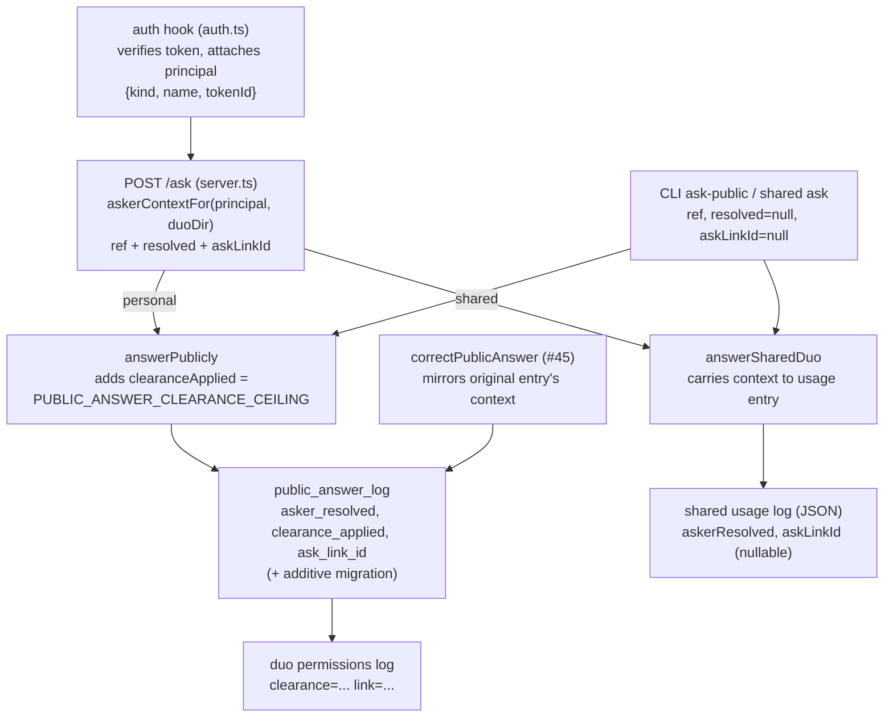

# Audit trail records ask-link asker context - Plan

## Goal Capsule

- **Objective:** After the fact, the owner can look at any answer given through `POST /ask` and see that it came through a shared ask link (named by token id, never the raw secret), whether that link's asker resolved to a directory identity, and — for personal answers, the only branch that applies a classification filter — the classification ceiling the answer was filtered through; with answers given while a link was valid surviving that link's later revocation unchanged.
- **Means:** Extend the two logs POST /ask already writes — the public-answer log (personal) and the shared usage log (shared) — with ask-link context columns, threaded from a principal that now carries the verified token's id (KD1, KTD1).
- **Authority hierarchy:** issue #160's acceptance criteria govern product behavior; R-IDs state requirements; KTD-IDs state implementation mechanism within those constraints.
- **Stop conditions:** all R-IDs hold, the full suite and typecheck are green under pinned Node, and `public_answer_log`'s append-only triggers are pinned unchanged (R6).
- **Execution profile:** TypeScript/ESM, vitest; every node/npm/npx invocation under pinned Node 22.22.3.
- **Who finishes and ships:** this plan's implementer, via the standard branch → tests → review → PR flow.

---

## Product Contract

### Summary

Every answer `POST /ask` gives is already logged — personal answers in `public_answer_log`, shared answers in the shared usage log — but the entries cannot say *how the question arrived*: an ask-link ask and the owner's own console ask are indistinguishable, resolution outcome is computed by the route and then discarded, and the log has no classification-ceiling field. This plan gives both logs which link (by id) and whether the asker resolved, and gives the personal log the ceiling applied — the shared path applies no classification filter, so it records no ceiling.

### Problem Frame

#159 wired `POST /ask` and resolved the asker against `duo/directory.json` for the log (its KTD5), but only the resolved *ref string* survives into the log entries — the resolved/unresolved outcome, the link's identity, and the ceiling `answerPublicly` filters through are all dropped on the floor. The epic #157 framing is parity: an ask-link asker's answers need the durability "like any other asker" (#51's log). Past answers from a since-revoked link must stay exactly as written.

### Key Decisions

- **Extend the logs POST /ask actually writes, not `audit_log`.** The issue's `listAuditEntries` wording names #51's log as the *standard* of durability; in reality POST /ask writes `public_answer_log` (personal, via `answerPublicly`) and the shared usage log (via `answerSharedDuo`), while `audit_log` is written only by the CLI per-asker path (`answerForAsker`). Forcing ask answers into `audit_log` would fabricate its per-asker columns (`records_excluded`, asker-keyed `clearance_applied`) — the exact forcing `src/permissions/public-answer-log.ts`'s module comment already rejects — and double-log every ask. The parity the AC asks for is delivered as *content* parity: the same three details, in the log where the answer lands. (session-settled: user-directed — chosen over forcing entries into `audit_log` or adding a new audit surface: the issue's own scope line says "extends the existing log's schema and content, not its surface".) Governs R1–R4.
- **Both /ask branches are covered.** The AC says "a question answered through `POST /ask`" without distinguishing `duo` modes, and the epic's in-scope line ("records the ask-link's resolved (or unresolved) asker identity like any other asker") is branch-agnostic; the shared usage log gets the link id and resolution outcome, and — because that path applies no classification filter — deliberately no ceiling field. Governs R4.

### Requirements

**What each personal answer records (`public_answer_log`)**

- R1. Every entry in `public_answer_log` names the ask-link token by **id** in a new `ask_link_id` column when the ask came through an ask link, and `null` when it did not (paired device or CLI ask); the raw token is never written anywhere.
- R2. Every entry records whether the asker resolved against `duo/directory.json` at answer time in a new `asker_resolved` column, tri-state: `true`/`false` when a lookup was performed (ask-link asks), `null` when none was (device principals log the fixed ref `owner`; CLI asks resolve nothing, per #43).
- R3. Every entry records the classification ceiling the answer was actually filtered through in a new `clearance_applied` column — `PUBLIC_ANSWER_CLEARANCE_CEILING` — the same detail every `audit_log` entry carries.

**What each shared answer records (usage log)**

- R4. Every shared answer logged through `POST /ask` records the ask-link token id (or `null`) and the `asker_resolved` tri-state in its usage-log entry; it records no clearance value, because the shared path does no classification filtering.

**Durability**

- R5. Revoking or expiring an ask link changes nothing about entries written while it was valid: they remain in the log, unchanged, still naming that link's id.
- R6. `public_answer_log`'s append-only semantics hold exactly as before — both DB triggers still refuse UPDATE and DELETE after the schema extension, and the extension itself adds columns without rewriting existing rows.

**Compatibility and reads**

- R7. A store whose `public_answer_log` predates these columns upgrades in place on next open (additive `ALTER TABLE` migrations in the `drafts` precedent's shape); pre-existing rows read back with honest values — `ask_link_id` null (not recorded — the column did not exist; rows written between #159 and this change may have come through a link), `asker_resolved` null (not recorded — same window), `clearance_applied` the public ceiling every historical public answer was already filtered through.
- R8. The non-route writers keep writing valid entries with honest values: `duo permissions ask-public` (no link, `null` resolution), `duo shared ask` (same), and #45's correction flow — a correction entry carries the original entry's asker context, because it is part of that exchange's trail, not a new ask.
- R9. `duo permissions log`'s summary line surfaces the new context — the ceiling always, the link id when present — so the owner can actually see it in the existing read surface.

### Scope Boundaries

**In scope:** the two logs' schema and content; the principal and route wiring that carries the context; the CLI log line; migration for pre-existing stores.

**Out of scope (non-goals):**

- Any new audit UI or HTTP read surface — the issue's own line; #159's PR body already records the `GET /answers` follow-up separately.
- Touching `audit_log` / `listAuditEntries` / `GET /audit` at all — #51's surface stays byte-identical.
- Any behavioral use of resolution — resolution still feeds the logs only (#159 R9/KTD5 unchanged).
- Fixing the cross-process store race (#159 R12 residual) or the shared usage log's whole-file rewrite (#197 unapplied #1).

---

## Planning Contract

### Key Technical Decisions

- KTD1. **The principal carries the verified token's id; the route decides what to log.** `Principal` (`src/serve/auth.ts`) gains the verified token's id — the ask link's id for ask principals, the device token's id for device principals — attached at both attachment sites (the ask site has `ask.id` in hand; the device site's cache already carries `deviceId`). Auth states the fact; the logging policy (log the id only for ask principals) stays in the route/log layer. Ask tokens verify uncached per request (#159 KTD2), so the id is always the just-verified link's. Governs R1, R5.
- KTD2. **`asker_resolved` is tri-state (`true | false | null`), not the audit_log boolean.** `null` means "no directory lookup was performed" (device principal, CLI asks, pre-#160 rows — null there means *not recorded*, which for rows written in the #159–#160 window is not the same as no lookup having run); `true`/`false` mean a lookup was performed and matched/didn't (ask-link asks, including the malformed-directory fallback, which is an attempted-and-failed lookup). Chosen over mirroring `audit_log`'s `NOT NULL` boolean: `false` beside the fixed ref `owner` would read as "unresolved stranger", and `true` would fabricate a lookup that never ran. Governs R2, R4, R7, R8.
- KTD3. **The migration copies the `drafts` precedent exactly.** A `PUBLIC_ANSWER_LOG_MIGRATIONS` list (`column` + `ddl` pairs) applied after `CREATE TABLE IF NOT EXISTS`, gated on `PRAGMA table_info(public_answer_log)` — the pattern `src/drafting/draft-log.ts` established for the same already-running-`duo serve` hazard. Defaults: `ask_link_id TEXT` (null), `asker_resolved INTEGER` (null), `clearance_applied TEXT NOT NULL DEFAULT 'official_open'` — that default is a true backfill, not a fabrication, because every public answer ever written was filtered through exactly `PUBLIC_ANSWER_CLEARANCE_CEILING` = `CLASSIFICATION_LEVELS[0]` = `official_open`; the CREATE TABLE body also gains the three columns so fresh stores never migrate. `ALTER TABLE ADD COLUMN` rewrites no rows, so R6's triggers and R5's history are untouched. Governs R6, R7.
- KTD4. **`answerPublicly` owns the ceiling; callers own the asker context.** The `askerRef: string` parameter becomes one structured asker-context value (`ref`, `resolved`, `askLinkId`), and all three log sites write `clearanceApplied: PUBLIC_ANSWER_CLEARANCE_CEILING` from the module's own constant — callers cannot misstate it. Typecheck forces the two callers (route, `runAnswerPublicly`) and `public-correction.ts` to choose values explicitly. Governs R1–R3, R8.
- KTD5. **Shared usage-log entries gain the fields with load-time normalization, and no ceiling.** `SharedDuoUsageEntry` gains `askerResolved: boolean | null` and `askLinkId: string | null`; `loadUsageLog` normalizes absent fields to `null` so pre-#160 JSON entries read honestly without every consumer narrowing. No clearance field: `answerSharedDuo` does no classification filtering (v1-spec §3), and recording one would fabricate policy that does not exist. `answerSharedDuo`'s `askerId: string` parameter becomes the same structured context shape as the personal path's. Governs R4, R8.
- KTD6. **A correction mirrors the original's context.** `correctPublicAnswer` already re-records the original's `askerRef`/`draftId` on the correction entry; it now also carries the original's `askerResolved`, `askLinkId`, and `clearanceApplied`, so the correction stays inside the same exchange's audit trail. Governs R8.

### High-Level Technical Design

Where each new value originates and lands:

### Assumptions

- The shared branch is in scope (the AC's "a question answered through `POST /ask`" covers both `duo` modes; inferred from the issue text and the epic's branch-agnostic framing).
- `asker_resolved` semantics are tri-state rather than audit_log's boolean (inferred honesty call — see KTD2).
- The owner needs the context visible in the existing CLI read line, or "the owner reviews the audit log" is true only of raw SQLite (inferred from the AC's When/Then).
- Shared-branch ask-link context is written to the usage-log JSON but surfaced by no existing read command in #160 — `duo shared report` counts askers only — because the issue's out-of-scope line rules out new read surfaces; personal-branch visibility is delivered by R9's CLI line alone (accepted asymmetry; a shared read line would be a follow-up in #159's `GET /answers` spirit, not #160 work).
- `node:sqlite` accepts `ALTER TABLE ... ADD COLUMN` with these defaults on a STRICT table — the `drafts` migrations run under the same engine; a migration test verifies it rather than trusting this.
- Token ids are UUIDs minted by `createAskToken`; no PII concern in logging them, and `duo ask-link list` already exposes them to the owner.

### System-Wide Impact

- `Principal` gains a field every future route can see; nothing reads it outside `/ask` yet.
- `answerPublicly` and `answerSharedDuo` signatures change — every caller (route, two CLI wrappers, tests) is enumerated by typecheck.
- The public-answer log's schema becomes the second migrated table, reinforcing the `PRAGMA table_info` + `ALTER TABLE` convention for every future column addition.
- No HTTP response body changes on any route; `GET /audit` and `duo permissions audit` are untouched.

### Risks & Dependencies

- **Migration on a trigger-guarded table:** `ADD COLUMN` must not trip or weaken the append-only triggers — pinned by asserting old rows are byte-unchanged and UPDATE/DELETE still abort after migration (R6).
- **Signature ripples:** the structured-context change touches every `answerPublicly`/`answerSharedDuo` call site in src and test — bounded, typecheck-enumerated.
- **Fixture weight:** serve-level assertions reuse the existing `passed_on` (empty store) shape; only the answered-outcome test needs `seedAnsweredTopic`.
- **Environment:** suite only green under Node 22.22.3 (`node:sqlite` + FTS5); baseline 1059/1059.

### Sources / Research

- `src/permissions/public-answer-log.ts` — the log to extend; module comment documents why it is not `audit_log`.
- `src/permissions/audit.ts` — #51's column vocabulary (`asker_ref`/`asker_resolved`/`clearance_applied`) and trigger pattern being mirrored.
- `src/permissions/public-answer.ts` — `answerPublicly`'s three log sites, `PUBLIC_ANSWER_CLEARANCE_CEILING`.
- `src/permissions/public-correction.ts` — the correction writer whose entries must carry context (KTD6).
- `src/serve/auth.ts` — `Principal`, both attachment sites, uncached ask verification.
- `src/serve/server.ts` — `askerRefFor` (KTD5 of #159), both /ask branches.
- `src/serve/tokens.ts` — `AskToken.id`, `createAskToken`, `revokeAskToken`.
- `src/shared-duo/answer.ts`, `src/shared-duo/usage-log.ts` — the shared writer and JSON log to extend.
- `src/drafting/draft-log.ts` — the `PRAGMA table_info` + `ALTER TABLE` migration precedent (KTD3).
- `src/cli.ts` (`permissions log`, `permissions audit` lines), `src/commands/permissions.ts`, `src/commands/shared.ts` — CLI writers and the read line.
- `docs/plans/2026-09-20-1649-feat-post-ask-route-plan.md` — #159's KTD5 (resolution feeds the log only) and deferred-to-#160 audit work; `docs/plans/2026-09-20-1356-feat-ask-link-tokens-plan.md` — #158's token model.
- Issue #160 (ACs, out-of-scope), epic #157, PR #197 body (log surfaces, `GET /answers` follow-up).
- `docs/solutions/best-practices/ask-token-cache-policy-immediate-revocation.md` — why ask tokens verify uncached (the id the route logs is always the just-verified link's).

---

## Implementation Units

### U1. `public_answer_log` schema extension and in-place migration

- **Goal:** The table carries `asker_resolved`, `clearance_applied`, and `ask_link_id`; pre-existing stores upgrade in place; append and read handle the new columns.
- **Requirements:** R2, R3, R6, R7 (schema side of R1).
- **Dependencies:** none.
- **Files:** `src/permissions/public-answer-log.ts` (modify), `test/public-answer.test.ts` (extend).
- **Approach:**
  1. Add the three columns to the CREATE TABLE body and to `PublicAnswerLogEntryInput`/`PublicAnswerLogEntry`/`PublicAnswerLogRow`/`rowToEntry`/the INSERT.
  2. Add a `PUBLIC_ANSWER_LOG_MIGRATIONS` list and the `PRAGMA table_info` loop in `ensurePublicAnswerLogSchema`, mirroring `ensureDraftLogSchema`; defaults per KTD3, with a comment on why the `clearance_applied` default is a true backfill.
  3. Update the module doc comment: the #160 columns, the `listAuditEntries` reconciliation (why this log, not `audit_log`), citing the issue number.
- **Patterns to follow:** `src/drafting/draft-log.ts` `DRAFT_LOG_MIGRATIONS` + `ensureDraftLogSchema`; `src/permissions/audit.ts`'s column naming.
- **Test scenarios:**
  - Fresh store: append writes all three fields; `listPublicAnswerLogEntries`/`getPublicAnswerLogEntry` read them back (tri-state `null`, the ceiling constant, a link id).
  - Pre-#160 store: create the table by hand without the new columns (or via an old-shape DDL), append one old-shape row, then open through `ensurePublicAnswerLogSchema` — the row is unchanged and reads `askerResolved: null`, `askLinkId: null`, `clearanceApplied: "official_open"`; a new append succeeds.
  - After migration, UPDATE and DELETE on the table still abort with the append-only trigger messages.
  - Migration is idempotent: a second ensure pass adds nothing and appends still work.
- **Verification:** new log-level scenarios pass under `npx vitest run test/public-answer.test.ts`; the file's pre-existing `answerPublicly` cases fail at runtime until U2 updates the append callers (node:sqlite rejects undefined bindings at runtime, not just at typecheck), so **U1 and U2 verify together** — `npm run typecheck` is expected red until U2 for the same reason.

### U2. Asker context through `answerPublicly`, the CLI wrapper, and corrections

- **Goal:** The personal answering path writes the full asker context; the CLI and correction writers supply honest values.
- **Requirements:** R1–R3, R8 (personal/CLI/correction side).
- **Dependencies:** U1.
- **Files:** `src/permissions/public-answer.ts` (modify), `src/commands/permissions.ts` (modify), `src/permissions/public-correction.ts` (modify), `test/public-answer.test.ts`, `test/public-correction.test.ts` (extend).
- **Approach:**
  1. Replace `answerPublicly`'s `askerRef: string` with one structured asker-context parameter (`ref`, `resolved`, `askLinkId` — the exact shape is implementation's to name); all three log sites write `askerRef: ctx.ref`, `askerResolved: ctx.resolved`, `askLinkId: ctx.askLinkId`, `clearanceApplied: PUBLIC_ANSWER_CLEARANCE_CEILING` (KTD4).
  2. `runAnswerPublicly` passes `{ref: askerRef, resolved: null, askLinkId: null}` — #43's no-resolution semantics, now stated rather than implicit.
  3. `correctPublicAnswer` mirrors `original.askerRef/askerResolved/askLinkId/clearanceApplied` onto the correction entry (KTD6).
- **Patterns to follow:** the existing doc-comment conventions citing issue numbers; `answerForAsker`'s structured audit input.
- **Test scenarios:**
  - CLI-path entries (`answerPublicly` with null context) record `askerResolved: null`, `askLinkId: null`, `clearanceApplied: "official_open"` for all three outcomes (answered, passed_on, declined_refused — the cheap two via empty store / refusals file).
  - A correction entry carries the original's `askerResolved`, `askLinkId`, and `clearanceApplied`; the original entry is untouched.
- **Verification:** scenarios pass; `npm run typecheck` clean after U3/U4 update the remaining caller (the route), or green now if U2 and U4 land together.

### U3. Shared usage-log asker context

- **Goal:** Shared entries record the link id and resolution outcome; old JSON entries read as null.
- **Requirements:** R4, R8 (shared/CLI side).
- **Dependencies:** none (U4 wires the route into it).
- **Files:** `src/shared-duo/usage-log.ts` (modify), `src/shared-duo/answer.ts` (modify), `src/commands/shared.ts` (modify), `test/shared-duo-usage-log.test.ts`, `test/shared-duo-answer.test.ts` (extend).
- **Approach:**
  1. `SharedDuoUsageEntry` gains `askerResolved: boolean | null` and `askLinkId: string | null`; `loadUsageLog` normalizes absent fields to `null`; `appendUsageEntry` writes them (KTD5).
  2. `answerSharedDuo`'s `askerId: string` becomes the structured context (same shape as the personal path's), threaded into the usage entry; the doc comment's "never resolved against a directory" line is updated to state the #160 exception: entries from POST /ask carry the route's resolution outcome, CLI entries stay `null`.
  3. `runSharedAsk` passes `{id: askerId, resolved: null, askLinkId: null}`.
- **Patterns to follow:** the field-present-logic-deferred comments in the same file (`citedTitles`/`staleCitation`).
- **Test scenarios:**
  - New entries persist both fields; a usage-log JSON file whose entries lack the fields loads with `null`s (pre-#160 file).
  - `answerSharedDuo` with a resolved context writes `askerResolved: true` and the given `askLinkId`; with the CLI shape writes nulls.
  - Existing usage-report behavior (`unresolvedQuestionGaps`) unaffected.
- **Verification:** scenarios pass under `npx vitest run test/shared-duo-usage-log.test.ts test/shared-duo-answer.test.ts`.

### U4. Principal token id, POST /ask wiring, revoked-link durability

- **Goal:** The route threads the full context into both branches; a since-revoked link's past entries are pinned unchanged.
- **Requirements:** R1, R2, R4, R5.
- **Dependencies:** U1, U2, U3.
- **Files:** `src/serve/auth.ts` (modify), `src/serve/server.ts` (modify), `test/serve-server.test.ts` (extend).
- **Approach:**
  1. `Principal` gains the verified token's id, attached at both sites (KTD1); no other auth behavior changes.
  2. Replace `askerRefFor` with a context builder: device → `{ref: "owner", resolved: null, askLinkId: null}`; ask → resolve against the directory (same try/catch fallback), `{ref: resolved ? identity.id : name, resolved: match ? true : false, askLinkId: principal.tokenId}`; malformed directory → `resolved: false` with the raw name (attempted-and-failed, per KTD2).
  3. Pass the context into `answerPublicly` and `answerSharedDuo` on their respective branches; nothing else in the route changes.
- **Patterns to follow:** #159's KTD5 comment block on the current `askerRefFor`; the existing `/ask` describe blocks' fixtures.
- **Test scenarios:**
  - Ask token named for an in-directory id: the public-answer-log row records `ask_link_id` = the minted link's id, `asker_resolved: true`, `clearance_applied: "official_open"` (AC1, personal, `passed_on` shape on an empty store).
  - Ask token named off-directory: `asker_resolved: false`, `asker_ref` = raw name, link id still recorded.
  - Malformed `directory.json`: still 200, `asker_resolved: false`, raw name.
  - Device principal: `ask_link_id: null`, `asker_resolved: null`, `asker_ref: "owner"`.
  - Shared ask via ask token: the usage entry records `askLinkId` = the link's id and the resolution outcome; via device token: nulls (AC1, shared).
  - **AC2 pin:** mint → successful personal and shared asks → `revokeAskToken` → assert both entries still exist, unchanged, still naming the link's id; a further `/ask` with the same bearer is 401 (revocation works, history survives).
  - The raw token string appears nowhere in either log (assert against the stored entries).
- **Verification:** scenarios pass under `npx vitest run test/serve-server.test.ts`; the full suite and `npm run typecheck` green.

### U5. `duo permissions log` surfaces the context

- **Goal:** The owner sees the new details in the existing CLI read line.
- **Requirements:** R9.
- **Dependencies:** U1 (fields exist).
- **Files:** `src/cli.ts` (modify), `test/permissions-cli.test.ts` (extend).
- **Approach:** Extend the summary line with `clearance=${entry.clearanceApplied}` always and `link=${entry.askLinkId}` when present, matching `duo permissions audit`'s `clearance=` convention; no new flags.
- **Patterns to follow:** the `permissions log` line's existing conditional-suffix style (`topic=`, `corrects=`).
- **Test scenarios:**
  - A log containing an ask-link entry and a non-link entry prints `link=<id>` on the first and omits it on the second; both print `clearance=official_open`.
- **Verification:** scenario passes under `npx vitest run test/permissions-cli.test.ts`.

---

## Verification Contract

- All commands under pinned Node 22.22.3 (`PATH="$HOME/.nvm/versions/node/v22.22.3/bin:$PATH"`); `node:sqlite` + FTS5 break otherwise.
- `npx vitest run test/public-answer.test.ts test/public-correction.test.ts test/shared-duo-usage-log.test.ts test/shared-duo-answer.test.ts test/serve-server.test.ts test/permissions-cli.test.ts` — the touched suites.
- `npm test` — full suite (baseline 1059/1059; new tests add to it).
- `npm run typecheck` — clean.
- No CI on this repo by design; these gates are the shipping evidence.
- Behavioral gates the suite must visibly pin: the AC1 triple (link id, resolution outcome, ceiling) on both branches; the AC2 revoked-link history pin; append-only triggers still aborting after migration; pre-#160 stores upgrading in place.

## Definition of Done

- All R-IDs hold and every unit's Verification is satisfied; full suite green and typecheck clean under pinned Node.
- `audit_log`, `listAuditEntries`, `GET /audit`, and `duo permissions audit` are untouched; every existing answer behavior is byte-identical.
- `public_answer_log`'s append-only semantics are enforced exactly as before and pinned by tests (R6).
- The reconciliation decision (this log, not `audit_log`) is documented in the module comment and the PR body.
- No dead-end or experimental code from abandoned approaches remains in the diff.
