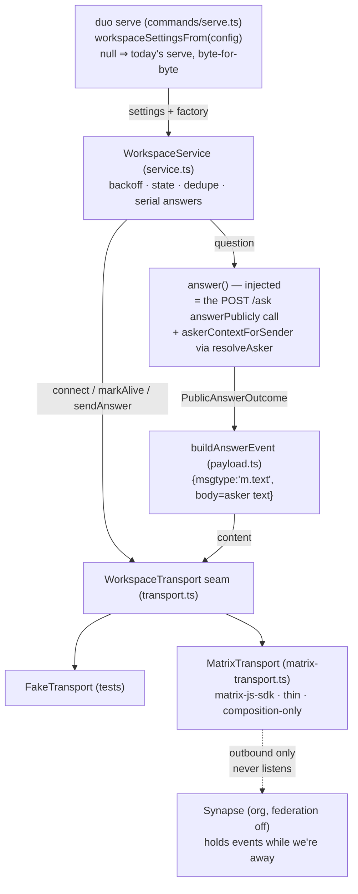

# The daemon dials out to the workspace - Plan

## Goal Capsule

- **Objective:** A configured `duo serve` opens one authenticated **outbound** Matrix connection to the org homeserver and holds it; questions arriving over it run the existing answering pipeline scoped by the resolved asker and the answer returns over the same connection as the duo's own message; disconnection is a recorded state with reconnect/backoff, and the homeserver's hold-not-loss survives at the seam; the bind posture and the corpus boundary are pinned unchanged by tests.
- **Means:** A new `src/workspace/` module wrapping `matrix-js-sdk` behind a narrow transport seam (connect / stop / sendAnswer / markAlive / onMessage / onDisconnected), a service owning backoff, state, dedupe and the answer loop, and a payload builder whose output shape is the only thing that can cross the wire (questions in, asker-visible answer text out).
- **Authority hierarchy:** issue #186's acceptance criteria govern behavior; `docs/workspace-platform.md` (MERGED) governs architecture — Matrix protocol, org-hosted Synapse, federation off, the daemon dials out, §5 the corpus/passphrase never cross, §6 the duo is its own Matrix user whose credentials never leave the daemon; R-IDs below state requirements, KTD-IDs implementation mechanism.
- **Stop conditions:** all R-IDs hold; full suite + typecheck green under pinned Node 22.22.3; the existing bind tests and the egress scan stay green unmodified (except no modification is planned at all).
- **Execution profile:** TypeScript/ESM (NodeNext), vitest with fake timers + a fake transport; `matrix-js-sdk` pinned `42.4.0` (Apache-2.0, verified in the decision record §10 and against npm).
- **Who finishes and ships:** this plan's implementer, via the standard branch → tests → review → PR flow; squash-merge per the chain brief.

---

## Product Contract

### Summary

The workspace epic (#184) needs team messaging without an inbound rule on the owner's Mac. This story is the mechanism: the daemon dials out to the org's Matrix homeserver, holds the connection, answers work that arrives down it on the SAME pipeline `POST /ask` uses, and records disconnection as a state rather than an error. Nothing inbound opens; nothing corpus-shaped crosses.

### Problem Frame

The client is a messaging product (#184), but AR-12 forbids a listening socket beyond the tailnet and G3's MDM profile forbids inbound + VPN. `docs/workspace-platform.md` §5 states the mechanical answer: connection direction holds the boundary — the daemon dials out. Matrix additionally gives held-not-lost natively (the homeserver holds events for an offline user; sync catches up on reconnect), so the daemon side only owes: dial, authenticate as the duo's own user, answer, report liveness, reconnect with backoff.

### Key Decisions

- **Matrix per the merged decision record, wrapped at a seam.** `matrix-js-sdk` is a library capability, not a product surface: every workspace file except the thin adapter depends on `WorkspaceTransport`, never on the SDK. Tests run against a fake; the adapter is composition-wired only.
- **No second answering path.** The service receives an injected `answer` function; `runServe` wires it to the very `answerPublicly` call `POST /ask` makes, with the asker resolved through the existing `resolveAsker`/`loadDirectory`. The workspace module is structurally forbidden (import-scan test) from importing corpus modules — the pipeline arrives by dependency inversion.
- **Asleep-duo decision record absent ⇒ config-driven parameters.** Branch `issue-188-asleep-duo-decision` carries no `docs/workspace/asleep-duo.md` (verified: its only diff is unrelated #179 docs). Hold-retention/asker-messaging parameters are therefore config knobs with conservative defaults (backoff initial/max, presence interval), for #188 to retune without code change.
- **v1 question scope: direct rooms only.** A question is a text message from someone else in a two-member room the duo is joined to. Group-room addressing, mentions, consent and governance are #189/#192.

### Requirements

**The daemon dials out**

- R1. With complete workspace config (`DUO_WORKSPACE_HOMESERVER`, `DUO_WORKSPACE_ACCESS_TOKEN`, `DUO_WORKSPACE_USER_ID`), `duo serve` starts an outbound connection that authenticates as the duo's own Matrix user and is held open; the HTTP listener behaves exactly as today.
- R2. With no workspace env set at all, `duo serve` is byte-for-byte today's behavior — no workspace code path runs. Partial config refuses to boot with an error naming the missing keys, before any socket opens.
- R3. Connection loss triggers reconnect with capped exponential backoff (config: initial/max delay); a successful connect resets the attempt count; `stop()` cancels pending retries and is idempotent.
- R4. Connection state is observable — `state()` plus a change subscription — with phases `stopped | connecting | connected`, a transition timestamp, last-alive time and attempt count, so #187's availability states have their source.

**Nothing inbound is opened**

- R5. The workspace module contains no listening primitive: no `listen(`, no `createServer`, no `node:http`/`node:net`/`ws` import (its only dependency-level network capability is `matrix-js-sdk`). The existing bind tests stay green unmodified, and `assertServableHost` still refuses wildcard hosts.

**Work arrives over the open connection**

- R6. A text message from another user in a direct (two-member) room the duo is in reaches the answering pipeline as the same `answerPublicly` call `POST /ask` runs, with the sender mapped to an `AskerContext` through `resolveAsker` (localpart of the Matrix id as the lookup key; full sender id logged when unresolved; no ask link). The answer — or the passed-on/refusal text — returns over the same connection as the duo's own message in the question's room.
- R7. Questions are answered serially (the pipeline opens the store per call); an answering failure logs server-side and sends the same generic asker-visible failure text `POST /ask` sends, never internals; one question is answered at most once per process (event-id dedupe).
- R8. While connected, the daemon reports liveness to the homeserver on (re)connect and on a configurable interval (presence/last-seen, AC "disconnected duo is a recorded state").

**A disconnected duo is a state, not an error**

- R9. Events the homeserver held during a disconnect are received and answered after reconnect — verified at the seam: no daemon-side queue exists or is needed; the reconnect contract (connect resolves ⇒ caught up ⇒ held events delivered) is the tested behavior, documented in the module.

**The corpus never crosses**

- R10. The outbound payload's shape is pinned: exactly `{ msgtype: "m.text", body }`, where `body` is the asker-visible text (`answered.text`, or the passed-on/refusal message) — the same projection `POST /ask` sends an asker. Owner-only fields (draftId, logEntryId, confidence, topicId, evidenceAgeDays, ownerNotice) and any store/records/evidence/rules/passphrase material are structurally absent: a poisoned-outcome test asserts none of it serializes, and an import-boundary test forbids `src/workspace/**` from importing store/ingest/derivation/drafting/corrections.

### Scope Boundaries

**In scope:** the transport seam, the Matrix adapter, the service (backoff/state/dedupe/serial answering), the payload builder, asker mapping, workspace config parsing + validation, `runServe` wiring with an injectable transport factory, and the tests pinning all of the above.

**Out of scope (non-goals):**

- The workspace directory itself (#187) — v1 maps Matrix localpart → directory id through the existing `resolveAsker`; #187 formalizes the mapping.
- Conversations, message store contract, read state, durable cross-restart dedupe (#189) — v1 dedupes event ids in memory; a daemon restart re-reads the sync window and may re-answer a question still inside it (documented in the service; the homeserver's initial-sync window bounds it).
- Consent/room-governance beyond direct rooms (#192); E2EE (#191) — v1 is plaintext on the closed org server; files; bridges.
- Any CLI command for provisioning credentials, and any move of the access token into the encrypted store (#187's pairing story may do that; today it rides `DUO_WORKSPACE_ACCESS_TOKEN` exactly as `DUO_PASSPHRASE` and `DUO_JEV_API_KEY` do — env, never a committed file, never written anywhere by us).
- Editing `docs/implementation-plan.md` (forbidden) or touching other issues.

---

## Planning Contract

### Key Technical Decisions

- KTD1. **The seam is six calls, Matrix-shaped but SDK-free** (`src/workspace/transport.ts`): `connect(): Promise<void>` (resolves only when the first sync is prepared — i.e. caught up), `stop()`, `sendAnswer(roomId, content)`, `markAlive()`, `onMessage(handler)` (normalized candidate messages, not filtered questions), `onDisconnected(handler)`, plus `selfUserId`. Filtering lives in the service layer so the policy is test-covered; the adapter stays a dumb normalizer. Governs R1, R6, R9.
- KTD2. **Backoff is ours, not the SDK's.** The SDK's internal sync retries cover transient drops without surfacing `onDisconnected`; we escalate only on `SyncState.Error`/`Stopped` or a failed `connect()`, then re-dial with capped exponential backoff (`min(initial·2^attempts, max)`), attempt count reset on success. Avoids two retry loops fighting. Governs R3.
- KTD3. **One answering path by construction.** `WorkspaceService` takes `answer: (question) => Promise<PublicAnswerOutcome>`; `runServe` supplies the exact `answerPublicly(...)` expression the `/ask` route uses (same args, same asker-context shape, `askLinkId: null`). The import-scan test (R10) makes a second pipeline structurally impossible inside `src/workspace/`. Governs R6, R10.
- KTD4. **Payload = the asker projection, literally.** `buildAnswerEvent(outcome)` returns `{ msgtype: "m.text", body }` with `body` taken only from `outcome.text`/`outcome.message` — the fields `POST /ask` already sends to askers (the composed text carries its own citations and attribution per `public-answer.ts`). No structured `sources` extra: the text already contains them, and fewer keys is a smaller boundary. Governs R10.
- KTD5. **Config follows the DUO_* pattern; credentials follow the passphrase pattern.** `loadConfig` gains a `workspace` section (three `undefined`-default strings + reconnect/presence numbers). `workspaceSettingsFrom(config)` returns `null` (off) when all three strings are unset, a `WorkspaceConfigError` naming the missing keys on partial config, and validates https + `@…:…` shapes — refusing at boot, before binding, like `assertServableHost`. The token is never persisted by us anywhere. Governs R1, R2, R8.
- KTD6. **`runServe` takes an optional transport factory; the default lazily imports the SDK.** `WorkspaceTransportFactory = (settings) => Promise<WorkspaceTransport> | WorkspaceTransport`. Default: dynamic `import("../workspace/matrix-transport.js")` — non-workspace daemons (and the existing serve tests) never even load `matrix-js-sdk`. Tests inject a fake. `close()` stops the workspace before the HTTP listener. Governs R1, R2.
- KTD7. **Held-not-lost is the reconnect contract, not a queue.** The homeserver holds events; `connect()` resolving means sync caught up; held events then arrive through `onMessage` exactly like live ones (the adapter forwards backlog and live timeline events alike — a message asked while the Mac was asleep must be answered on wake; cold-restart re-reads the sync window per the documented v1 boundary). The seam test simulates the hold and asserts delivery + answer after reconnect. Governs R9.
- KTD8. **Liveness is pushed, not polled**: `markAlive()` on every (re)connect and on `DUO_WORKSPACE_PRESENCE_INTERVAL_MS` (default 240000) while connected — the homeserver's presence/last-seen is server-side state we feed, never daemon-local truth. `lastAliveAt` is carried in `state()` for #187. Governs R4, R8.

### High-Level Technical Design

### Assumptions

- `matrix-js-sdk@42.4.0` (pinned): pure-ESM, adjacent `.d.ts` types resolve under NodeNext; named imports verified under pinned Node; `createClient/startClient/stopClient/sendMessage/setPresence/on(RoomEvent.Timeline, ClientEvent.Sync)` verified present.
- The three env vars are the whole workspace config surface for v1; homeserver + token + user id arrive together at pairing time (decision record §6 — credentials created on the owner's machine and never leaving the daemon).
- `SyncState.Prepared` firing ⇒ initial sync complete (SDK contract); `Error`/`Stopped` ⇒ service-level reconnect (KTD2).
- The asker projection of `/ask` (kind + text) is the sanctioned asker-visible vocabulary — mirroring it exactly, including the generic failure string, keeps one vocabulary (no workspace-specific wording to drift).
- In-memory event-id dedupe is acceptable for v1 (#189 owns durable read state); the restart re-answer window is bounded by the homeserver's initial-sync timeline limit.
- #188's decision record does not exist yet (branch verified) — config knobs stand in for its parameters.

### System-Wide Impact

- `package.json` gains `matrix-js-sdk` pinned `42.4.0` (+ lockfile). No other dependency changes.
- `loadConfig` gains a section — additive; every existing reader unaffected (config.test.ts extended).
- `runServe` gains an optional 4th parameter — additive; existing callers and tests compile unchanged.
- New top-level `src/workspace/` sits outside the egress scan's sanctioned set and keeps it that way: only `matrix-js-sdk` is imported (no `fetch`/`ws`/`node:http`), so the scan needs no edit (brief note 8 satisfied by not needing it).
- No new listening socket anywhere; bind posture untouched.

### Risks & Dependencies

- **SDK sync semantics untested against a live server** (suite must not run a homeserver): mitigated by the seam — all behavior under test is ours; the adapter is kept dumb enough that its correctness is mostly types.
- **Backlog replay re-answering on restart** (KTD7): documented v1 boundary, owned by #189; bounded by initial-sync window.
- **Big dependency in the graph**: lazy default import keeps it out of non-workspace processes and tests.
- **Fake-timer/async interplay in service tests**: standard vitest `useFakeTimers` + `await vi.advanceTimersByTimeAsync`.
- Environment: suite only green under Node 22.22.3; baseline green run recorded before implementation.

### Sources / Research

- `docs/workspace-platform.md` — the merged decision record (§1 protocol+SDK, §5 boundary, §6 duo identity, §7 federation off).
- Issue #186 (ACs), #184 (epic framing), #187/#189/#192 titles (successors), #188 (absent record, verified on branch).
- `src/serve/server.ts` — `POST /ask`'s `answerPublicly` call and `askerContextFor` (the path mirrored); `asker-visible` envelope.
- `src/permissions/public-answer.ts` — `PublicAnswerOutcome`, `AskerContext`, asker-visible vs owner-only fields; `cliAskerContext`.
- `src/permissions/directory.ts` — `resolveAsker`, `loadDirectory`, case-insensitive id match.
- `src/commands/serve.ts`, `src/serve/bind.ts`, `src/serve/passphrase.ts`, `src/serve/tokens.ts` — boot order, bind refusal precedent, credential-handling precedents (env token; hashed-stored minted tokens).
- `src/config.ts` + `test/config.test.ts` — DUO_* pattern to extend.
- `test/gitignore.test.ts` — the structural-scan idiom this plan's boundary tests copy.
- `matrix-js-sdk@42.4.0` — verified ESM import, method surface, `SyncState`/`ClientEvent`/`RoomEvent`/`SetPresence` enums.

---

## Implementation Units

### U1. Config + settings validation

- **Goal:** `loadConfig` carries the workspace section; `workspaceSettingsFrom` turns it into all-or-nothing validated settings.
- **Requirements:** R1, R2, R8 (knob side).
- **Files:** `src/config.ts`, `src/workspace/settings.ts`, `test/config.test.ts` (extend), `test/workspace-settings.test.ts` (new).
- **Approach:** defaults `DUO_WORKSPACE_RECONNECT_INITIAL_MS=1000`, `DUO_WORKSPACE_RECONNECT_MAX_MS=60000`, `DUO_WORKSPACE_PRESENCE_INTERVAL_MS=240000`; three string vars with no defaults; `workspaceSettingsFrom` returns `null`/throws `WorkspaceConfigError` (partial set, non-https homeserver, non-`@` user id) per KTD5.
- **Test scenarios:** defaults; all-unset ⇒ null; full set ⇒ settings echo; each partial combination throws naming missing keys; http homeserver refused; malformed user id refused.
- **Verification:** `npx vitest run test/config.test.ts test/workspace-settings.test.ts`.

### U2. The seam, question filter, asker mapping, payload builder

- **Goal:** The pure layer: transport types, `directQuestionFrom`, `localpartOf`/`askerContextForSender`, `buildAnswerEvent`.
- **Requirements:** R6 (mapping/filter side), R10.
- **Files:** `src/workspace/transport.ts`, `src/workspace/questions.ts`, `src/workspace/asker.ts`, `src/workspace/payload.ts`, `test/workspace-questions.test.ts`, `test/workspace-asker.test.ts`, `test/workspace-payload.test.ts` (all new).
- **Approach:** per KTD1/KTD3/KTD4; `askerContextForSender` mirrors `server.ts`'s `askerContextFor` try/catch-fallback semantics against `loadDirectory`+`resolveAsker`.
- **Test scenarios:** direct-question filter (2-member room, other sender, non-blank body ⇒ question; own messages, 3+ member rooms, blank bodies, non-text msgtypes ⇒ null); localpart extraction (incl. non-`@` fallback); resolved/unresolved/malformed-directory asker contexts; payload shape pinned to exactly two keys; poisoned outcome (markers in draftId/logEntryId/confidence/topicId/evidenceAgeDays/ownerNotice/sources-ids) serializes none of them; failure-body constant matches the `/ask` literal.
- **Verification:** the three new files green.

### U3. The service (backoff, state, held-not-lost, serial answers)

- **Goal:** `WorkspaceService` owns lifecycle per KTD2/KTD7/KTD8.
- **Requirements:** R3, R4, R6 (loop side), R7, R8, R9.
- **Files:** `src/workspace/service.ts`, `test/helpers/fake-workspace-transport.ts`, `test/workspace-service.test.ts` (new).
- **Approach:** sync `start()` kicks the async connect loop (serve never blocks on the workspace); states `stopped|connecting|connected`; capped-exponential reconnect; presence refresh interval while connected; serial answer queue; eventId dedupe; answering errors ⇒ console.error + generic failure body (never internals); idempotent `stop()` cancelling timers.
- **Test scenarios (fake timers + FakeTransport):** happy path connect→markAlive→state connected; question→pipeline→payload→sendAnswer with asker text; connect failure→backoff sequence (1s,2s,4s…capped)→success resets; disconnect mid-life→reconnect; **held events during disconnect delivered+answered after reconnect** (R9); dedupe same eventId once; second question waits for the first answer (serialization); pipeline throws ⇒ failure body sent + next question still answered; presence interval fires while connected, stops on disconnect/stop; stop() idempotent, no further connects; state transitions observable via onState.
- **Verification:** `npx vitest run test/workspace-service.test.ts`.

### U4. The Matrix adapter + serve wiring

- **Goal:** `createMatrixTransport` (thin, SDK-only) + `runServe` integration; boundary pinning tests.
- **Requirements:** R1, R2, R5, R6 (wiring side).
- **Files:** `src/workspace/matrix-transport.ts`, `src/commands/serve.ts` (modify), `test/workspace-serve.test.ts`, `test/workspace-boundary.test.ts` (new).
- **Approach:** adapter per KTD1/KTD2 (resolve on Prepared; escalate Error/Stopped; forward timeline text events live+backlog; guard stop from emitting disconnect); `runServe` gains optional factory param with lazy default import (KTD6), validates settings before binding, stops workspace in `close()`; boundary tests: structural scan (no listen/http/net/ws/fetch in `src/workspace`; no imports of store/ingest/derivation/drafting/corrections) + runServe wiring (workspace on ⇒ factory called + HTTP still serves /health + close stops both; workspace absent ⇒ factory never called, address unchanged shape).
- **Test scenarios:** as above; plus: existing `test/serve-cli.test.ts` / `serve-bind.test.ts` stay green unmodified (run them).
- **Verification:** new files + `npx vitest run test/serve-cli.test.ts test/serve-bind.test.ts`; then the full suite + `npm run typecheck`.

### U5. Simplify, review, ship

- ce-simplify-code pass over the branch diff; ce-code-review adversarial pass; apply findings; full suite + typecheck; conventional commit; PR per the chain brief's body contract; squash-merge; report.
