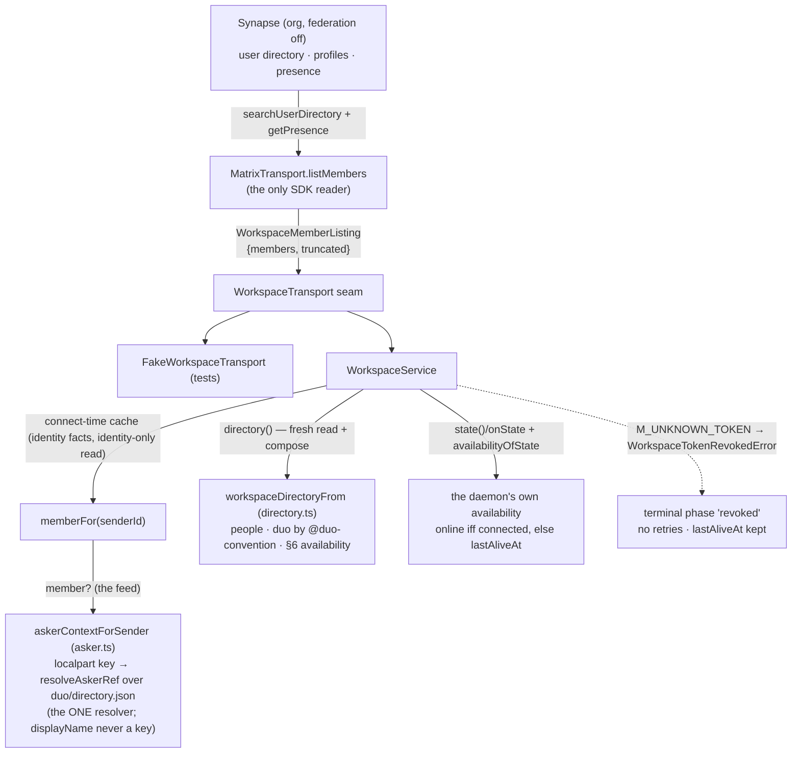

# Workspace identity and directory — people, and whose duo is whose - Plan

## Goal Capsule

- **Objective:** The workspace's directory is readable over the #186 seam: each member returns with a stable id (their Matrix user id), a display name, and availability; a member's duo — when one exists — is addressable, attributed to exactly that one person by the `@duo-<name>` convention, and carries its own availability per `asleep-duo.md` §6 (online = its daemon's outbound connection is live; offline = down + last-seen; never a statement about the owner's presence). The existing permissions path (`duo/directory.json` + `resolveAskerRef`) stays the resolution authority, fed by workspace member facts. No provisioning path exists anywhere. A revoked access token (`M_UNKNOWN_TOKEN`) fails fast into a distinct terminal state instead of looping.
- **Means:** One narrow seam addition (`listMembers` + its identity-only variant `listMemberIdentities` + presence/member types + `WorkspaceTokenRevokedError`), one new pure module (`src/workspace/directory.ts`) composing the directory and deriving owner↔duo linkage from the naming convention, a connect-time member-identity cache in `WorkspaceService` feeding the asker mapping, the Matrix adapter implementing the reads via `searchUserDirectory` (+ paced per-user `getPresence` for the full read), and tests against the fake.
- **Authority hierarchy:** issue #187's acceptance criteria govern behavior; `docs/workspace-platform.md` (MERGED — §6 the duo's identity is structural, credentials created on the owner's machine during pairing) governs attribution; `docs/workspace/asleep-duo.md` (MERGED — §6 availability semantics) governs the availability vocabulary; #219's successor notes govern the revoked-token follow-up.
- **Stop conditions:** all R-IDs hold; full suite + typecheck green under pinned Node 22.22.3; the existing egress/listener scans stay green; `src/workspace/questions.ts` untouched (sibling #189's file).
- **Execution profile:** TypeScript/ESM (NodeNext), vitest with fake timers + the fake transport; `matrix-js-sdk` pinned `42.4.0` behind the adapter only.
- **Who finishes and ships:** this plan's implementer, via branch → tests → simplify → adversarial review → PR → squash-merge per the chain brief.

---

## Product Contract

### Summary

A messaging product needs to know who people are; this one also needs to know whose duo is whose. #186 gave the daemon an outbound Matrix connection; this story makes the workspace's identity surface real on top of it — the member directory read, duo attribution, availability per the asleep-duo record, and the bridge from Matrix user ids to the existing asker resolution — without moving the permissions authority or opening any provisioning path.

### Problem Frame

`duo/directory.json` is a permissions file for resolving askers — not a user directory, and not multi-user. The workspace epic needs a read model of the workspace's people and their duos: #192 addresses a duo through it, the client (duo#62) renders it, and the asleep-duo record requires the asker to see a duo's availability before asking. On Matrix the homeserver already holds all of it (user directory, profiles, presence); the daemon only needs to read it over the held connection and compose it.

### Key Decisions

- **The directory is read, never assembled locally.** Every fact (id, display name, presence) comes from the homeserver over the seam; `src/workspace/directory.ts` only composes and derives.
- **Owner↔duo linkage is the `@duo-<name>` convention, no second registry.** The platform record (§6) already fixes the duo's id as `@duo-<owner-localpart>:<server>`; deriving the linkage from it adds no state to sync, no mapping file to maintain, and no way for two owners to contest a duo. The namespace `duo-*` is the record's, reserved.
- **Availability is two independent facts per person.** A member's own availability (their client's presence) and their duo's availability (the duo daemon's presence — fed by exactly the `markAlive` #186 ships) are carried separately; neither implies the other (§6).
- **`resolveAskerRef` stays the one resolver; the workspace feeds it member facts.** The localpart — a homeserver-administered namespace — remains the only lookup key; display names are deliberately NOT keys (an asker must not choose their own log identity), pinned by an anti-spoof test. Resolution is audit-log fidelity only — the public ceiling is uniform — so feeding it cannot change any permission.
- **Nobody gets a duo they did not create — structurally.** Nothing in `src/workspace/` can create a Matrix account: the adapter calls six SDK read/send methods and the scan pins that no provisioning primitive (register, createAccount, admin API) appears anywhere in the module. The only duo-credential creation remains local pairing (#186's env-token shape).

### Requirements

**People are addressable**

- R1. Reading the workspace directory over the seam returns one entry per person with a stable id (the Matrix user id), a display name (localpart when the profile has none), and availability. The raw listing carries a truncation flag; a server-capped listing is surfaced (logged), never silently swallowed.
- R2. Availability follows §6 exactly: `online` = the user's connection is live (no last-seen needed); `offline` = down, with last-seen as an ISO instant derived from the server's relative `last_active_ago` (null when the server has never seen them). The service's own state maps to the same vocabulary (`online` only while phase is `connected`; `lastAliveAt` is the last-seen otherwise).

**A duo belongs to exactly one person**

- R3. A member's duo, when a duo-shaped user matching the convention is listed, is attached to exactly that member: addressable by its own Matrix user id, carrying its own display name and availability (from its own presence — the daemon's connection, per §6).
- R4. A duo-shaped user with no listed owner is attributable to no one and is excluded from the person-keyed directory rather than guessed at. Duo-shaped ids never appear as people. A duo's asks are its own (never credited to its owner — AR-13's direction, applied to inbound work).

**The existing directory still resolves**

- R5. Askers for public answers resolve through `duo/directory.json` + `resolveAskerRef`, unchanged: the workspace member record (from the connect-time cache) feeds the mapping when present, the parse-only path remains the fallback, and both produce identical outcomes — pinned by test as the AC's "unchanged path". No second resolver, no second code path.

**Nobody gets a duo they did not create**

- R6. No code path in `src/workspace/` provisions, registers, or administers Matrix accounts. Pinned by a structural scan (the egress-scan idiom) over every workspace file.

**Revoked-token fail-fast** (from #219's successor notes)

- R7. When the homeserver rejects the access token with `M_UNKNOWN_TOKEN`, the adapter rejects with `WorkspaceTokenRevokedError` and the service stops retrying, records a distinct terminal `revoked` phase (observable via `state()`/`onState`, keeping `lastAliveAt`), tears the transport down, and logs re-pair guidance. A live revocation costs at most one re-dial (disconnect → re-dial → rejected connect → terminal), never a loop.

### Scope Boundaries

**In scope:** the seam addition (`listMembers`, member/presence/listing types, `WorkspaceTokenRevokedError`), `src/workspace/directory.ts` (convention derivation + composition + availability), the service's member cache / `directory()` read / revoked terminal phase / state-availability mapping, the member-fed asker mapping, the adapter's `listMembers` + token-error normalization, serve wiring of the fed resolver, and the tests pinning all of it.

**Out of scope (non-goals):**

- Exposing the directory over the daemon's HTTP surface (a route for the local client) — #192 decides where the daemon-side read is consumed; the client (duo#62) reads the homeserver itself.
- Pairing changes (moving the token out of env), credential refresh, soft-logout handling — the env-token shape stands; R7 only fails fast.
- Group rooms, mentions, consent (#192); message store / durable read state (#189); E2EE (#191); presence-list subscriptions or bulk-presence workarounds (the per-user `getPresence` fan-out is the documented pilot-scale cost; Matrix has no bulk presence API).
- Editing `docs/implementation-plan.md` (forbidden), `src/workspace/questions.ts` (sibling #189's), or any decision record.
- Provisioning, deprovisioning, or directory WRITE paths of any kind (R6 states the enforcement: they do not exist).

---

## Planning Contract

### Key Technical Decisions

- KTD1. **The seam gains one read (in two widths) + one error, both narrow** (`transport.ts`): `listMembers(): Promise<WorkspaceMemberListing>` where `WorkspaceMemberListing = { members: WorkspaceMember[]; truncated: boolean }`, `WorkspaceMember = { userId; displayName; presence }` extending `WorkspaceMemberIdentity = { userId; displayName }`, `WorkspacePresence = { online: boolean; lastActiveAgoMs: number | null }` (server-relative, no clock math at the seam), plus `listMemberIdentities(): Promise<WorkspaceMemberIdentityListing>` — the same read without the per-user presence fan-out, for callers that want identity facts only — and `WorkspaceTokenRevokedError` as the revoked-token signal adapters throw and the service recognizes. Presence stays raw at the seam (relative ms) so tests need no clock; ISO conversion happens once, in the composer. Governs R1, R7.
- KTD2. **Attribution is derived, not stored** (`directory.ts`): `DUO_LOCALPART_PREFIX = "duo-"`; `duoUserIdFor("@alice:ws") = "@duo-alice:ws"`; `duoOwnerUserIdOf` inverts. Composition indexes the listing by user id, emits people (non-duo-shaped localparts), and attaches the matching duo member to exactly one person. No registry, no sync, no ambiguity: the mapping is a bijection on ids by construction. Governs R3, R4.
- KTD3. **Availability composes once, §6-shaped** (`directory.ts` + `service.ts`): `availabilityFrom(presence, now)` for server-side facts; `availabilityOfState(state)` for the daemon's own connection (`online` iff phase `connected`, else `lastSeenAt = lastAliveAt`). Both produce `WorkspaceAvailability = { online; lastSeenAt: string | null }` — online carries no last-seen (§6: that is the whole definition). Governs R2.
- KTD4. **The asker feed is a parameter, not a second path** (`asker.ts`): `askerContextForSender(senderId, duoDir, member?)` — the optional member is the directory's record for that sender; the lookup key stays `localpartOf(userId)` and the fallback ref the full user id, so fed and unfed calls are behaviorally identical BY DESIGN (pinned), and the member's display name is never consulted (anti-spoof pin). The service caches the listing's identity facts at each successful connect (`refreshMembers` over the identity-only read — the connect path never pays the presence fan-out; fail-soft, stale-read discarded on re-dial) and `serve.ts` passes `memberFor(senderId)`. Governs R5.
- KTD5. **`directory()` reads fresh; the member cache is for identity only.** `WorkspaceService.directory()` does a live `listMembers` + compose and refuses (clear error) unless the connection is live; the connect-time cache serves stable identity facts to the asker feed and is never a source of availability (callers reading availability go through `directory()`). Governs R1, R2.
- KTD6. **Revocation is terminal, cheap to reach, and cheap to leave** (`matrix-transport.ts` + `service.ts`): the adapter recognizes `errcode === "M_UNKNOWN_TOKEN"` (duck-typed on the SDK's `MatrixError`) on both connect failure paths and rejects with `WorkspaceTokenRevokedError`; the service's dial catch enters the terminal `revoked` phase — timers cleared, presence interval stopped, transport stopped, member cache cleared, `running = false` (an explicit later `start()` may re-dial and re-discover it; nothing automatic does) — keeping `lastAliveAt` for the offline-with-last-seen story. Governs R7.
- KTD7. **The adapter's full read is two SDK calls, documented for what it is**: `searchUserDirectory({ term: "", limit })` (the Matrix user directory — the closed org homeserver's whole membership; empty term is match-all on Synapse, recorded as a deployment assumption for #192 to revisit) then per-user `getPresence`, fail-soft per user to `offline/never-seen` and paced at bounded concurrency (10 in flight, order preserved). `listMemberIdentities` is the same `searchUserDirectory` call with no presence fan-out. `display_name` falls back to the localpart (homeserver-issued, stable). Governs R1.
- KTD8. **No provisioning, pinned like the egress surface**: a scan block in `test/workspace-payload.test.ts` forbids account-creation primitives (`register(`, `registerRequest`, `createAccount`, `/_synapse/admin`, `/register`) in every file under `src/workspace/`, the same recursive-walk idiom the module boundary already uses. Governs R6.

### High-Level Technical Design

### Assumptions

- `searchUserDirectory({ term: "" })` returns the closed homeserver's users (Synapse treats an empty term as match-all); `limited: true` is the server's truncation signal and is surfaced, not retried here.
- `getPresence` returns `{ presence?, last_active_ago? }`; absent/failed presence composes to offline with no last-seen — a fact missing is a fact missing, never a guess.
- Matrix `presence: "online"` is the only live state (unavailable/offline both compose to offline) — §6 needs exactly the two-way split.
- The `@duo-<name>` convention is the platform record's reserved namespace; a person whose localpart collides with it is indistinguishable from a duo and the directory says so by exclusion (documented, tested).
- The member cache's identity facts (id, localpart, display name) are stable enough to cache across reconnects; presence is never cached (KTD5).
- The public-answer path's uniform clearance ceiling (public-answer.ts) makes asker resolution audit-fidelity-only — the premise under which feeding it is safe (KTD4).
- The sibling #189 chain owns `src/workspace/questions.ts`; this plan does not touch it. Other shared files (`transport.ts`, `service.ts`, fakes/tests) take additive edits only. One deliberate exception: `asker.ts`'s `localpartOf` definition moves to `directory.ts` (the user-id grammar owner) and is re-exported from `asker.ts` unchanged — public surface identical, callers unmodified.

### System-Wide Impact

- `WorkspaceTransport` gains two required read methods (`listMembers`, `listMemberIdentities`) — the fake and the two test-local transports implement them (additive edits to test files; no production signature changes).
- `WorkspacePhase` gains `"revoked"` (union extension; `state()` readers see a new value only on revocation).
- `askerContextForSender` gains an optional third parameter — existing callers compile unchanged.
- No config or settings changes (the read needs no knobs; the listing limit is an adapter constant).
- No new dependencies; no new listening sockets; the egress scan's sanctioned-import set is unchanged (`permissions` was already imported by `asker.ts`).

### Risks & Dependencies

- **Empty-term directory search is a Synapse behavior, not a spec guarantee** — pinned as a deployment assumption in the adapter's docs and the PR notes for #192; the client repo reads the homeserver directly and does not depend on this code.
- **Per-user presence fan-out** — O(n) requests per full `listMembers` read (paced, bounded concurrency; never paid on the connect path); acceptable at pilot scale, documented; no bulk API exists to migrate to.
- **Stale member cache during an outage** — identity facts only (KTD5); availability never served from it.
- **Interface addition forces test-fake updates** — additive; sibling conflicts possible in `workspace-service.test.ts` (rebase protocol per the chain brief).
- **`M_UNKNOWN_TOKEN` reachability** — the adapter recognizes it on connect-failure paths; a mid-life revocation costs one re-dial before the terminal state (pinned by test).

### Sources / Research

- Issue #187 (ACs), #184 (epic), #219 PR body (successor notes: availability via `state()`/`onState`, asker-mapping assumption, revoked-token fail-fast).
- `docs/workspace-platform.md` §5/§6 (boundary; the duo's identity is structural); `docs/workspace/asleep-duo.md` §6 (availability semantics).
- `src/workspace/{transport,service,asker,settings,matrix-transport,payload,questions}.ts` — the #186 seam this builds on.
- `src/permissions/directory.ts` (`resolveAskerRef`, `loadDirectory`), `src/permissions/public-answer.ts` (`AskerContext`, uniform ceiling), `src/serve/server.ts` (`askerContextFor` precedent), `src/commands/serve.ts` (wiring point).
- `matrix-js-sdk@42.4.0` typings — `searchUserDirectory` (`{ results: { user_id, display_name?, avatar_url? }[], limited }`), `getPresence` → `{ presence?, last_active_ago? }`, `MatrixError.errcode`.
- `test/workspace-payload.test.ts` — the recursive import-scan idiom KTD8 copies; `test/workspace-service.test.ts` — fake-timer harness to extend.

---

## Implementation Units

### U1. Seam + directory composition

- **Goal:** `transport.ts` additions; `directory.ts` complete (convention, availability, composition).
- **Requirements:** R1, R2, R3, R4.
- **Files:** `src/workspace/transport.ts`, `src/workspace/directory.ts`, `test/workspace-directory.test.ts` (new).
- **Verification:** `npx vitest run test/workspace-directory.test.ts`.

### U2. Service: member cache, directory read, revoked terminal, state availability

- **Goal:** `WorkspaceService` gains `refreshMembers`/`memberFor`/`directory()`, the `revoked` phase, and `availabilityOfState`; fakes extended.
- **Requirements:** R1, R2 (state half), R5 (cache half), R7.
- **Files:** `src/workspace/service.ts`, `test/helpers/fake-workspace-transport.ts`, `test/workspace-service.test.ts`.
- **Verification:** `npx vitest run test/workspace-service.test.ts`.

### U3. Asker feed + serve wiring

- **Goal:** `askerContextForSender(senderId, duoDir, member?)` + the serve answer-path wiring through `memberFor`.
- **Requirements:** R5.
- **Files:** `src/workspace/asker.ts`, `src/commands/serve.ts`, `test/workspace-asker.test.ts`, `test/workspace-serve.test.ts`.
- **Verification:** `npx vitest run test/workspace-asker.test.ts test/workspace-serve.test.ts`.

### U4. Adapter: listMembers + token-error normalization; provisioning pin

- **Goal:** The Matrix adapter implements the read and the revoked-token signal; the no-provisioning scan lands.
- **Requirements:** R1 (read half), R6, R7 (signal half).
- **Files:** `src/workspace/matrix-transport.ts`, `test/workspace-matrix-transport.test.ts`, `test/workspace-payload.test.ts`.
- **Verification:** `npx vitest run test/workspace-matrix-transport.test.ts test/workspace-payload.test.ts`; then the full suite + `npm run typecheck`.

### U5. Simplify, review, ship

- ce-simplify-code pass over the branch diff; ce-code-review adversarial pass; apply findings; full suite + typecheck under pinned Node 22.22.3; conventional commit; PR per the chain brief's body contract; squash-merge; report.
